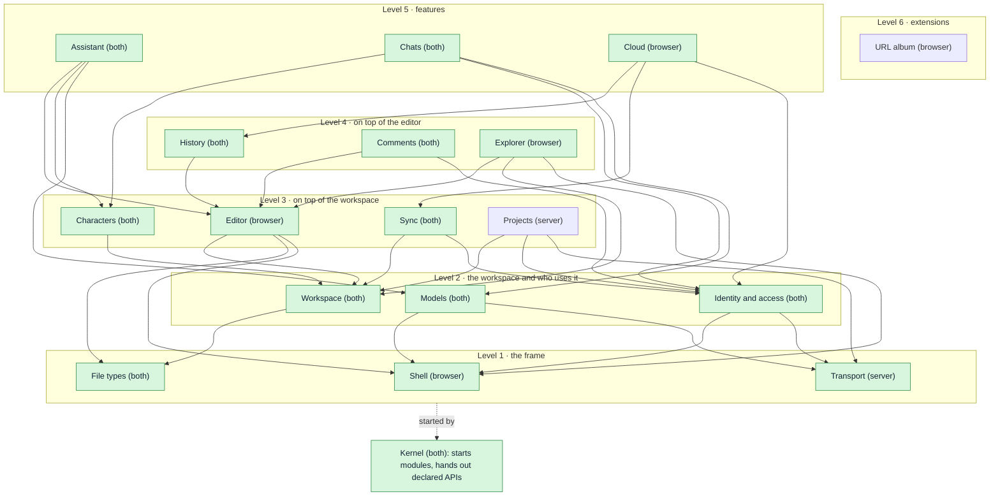
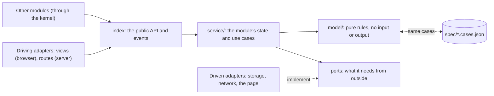
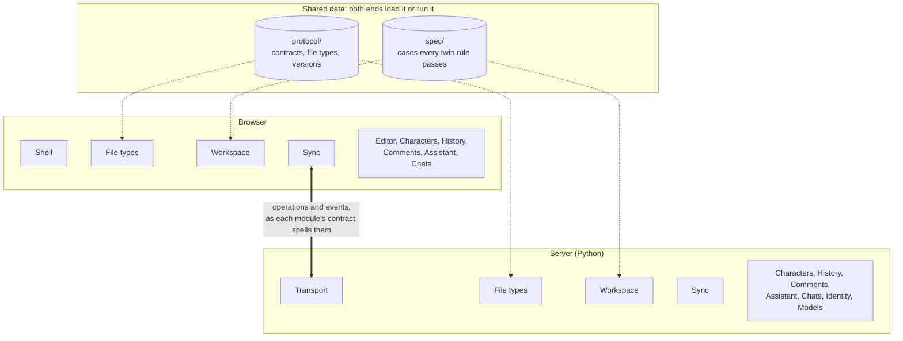
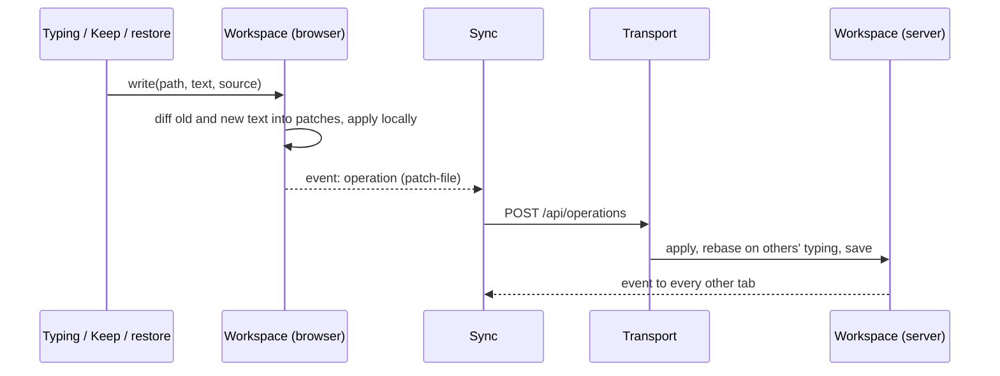

# Architecture

Stilo Marker is being restructured into a modular monolith on each end (decided
2026-10-16). The full design, with the reasoning, the module map and the order
of work, is in the "Module design" tab of the
[architecture review](https://claude.ai/code/artifact/ea78ba1f-1850-4b76-9642-8cffb14e6c7a).
This file is the short reference that the structure tests enforce.

## The shape

- **A tiny kernel** starts the modules in dependency order and hands each one
  only the public APIs it declared. It knows no domain (`app/kernel/`,
  `server/stilo/kernel/`). Its one piece of state is the browser's **trace**
  (see "Finding a bug" below).
- **Modules in one-way levels** (`app/modules/`, `server/stilo/modules/`):

  | Level | Modules |
  | --- | --- |
  | 1 | Shell (browser) / Transport (server), File types |
  | 2 | Workspace, Identity and access, Models |
  | 3 | Editor (browser), Sync (browser), Characters, Projects (server) |
  | 4 | History (browser), Comments (browser), Explorer (browser), Sync (server: it asks Projects who may open) |
  | 5 | Assistant, Chats (browser), Cloud (browser), History (server), Comments (server) |
  | 6 | Chats (server: a character's reply is the Assistant's agent), Cloud (server); in the browser, extensions (`extensions/<name>/`: the URL album, diagrams, module maps, Mermaid, HTML pages, tables, the theme pack), above every browser module |

- **Inside every module**: its definition (name, level, uses, owns: in a
  browser module the `defineModule({...})` its `index.js` exports, in a server
  module `module.json`), `index` (the public API and events), `model/` (pure
  rules), `service/` (state and use cases), `adapters/` (all input and output:
  views, routes, storage, network). Importing a browser module's `index.js`
  never touches the page; adapters reach the page only once started.
- **Between the ends**: each module's network messages live in
  `protocol/<module>.contract.json` with their own version (Identity's was
  the first, in v0.1.38). Sync's version is the old single sync number (117):
  both ends read it from `protocol/sync.contract.json`, and other modules'
  events ride Sync's stream. A route may name the browser module that calls
  it (`"caller"`) when that is not the contract's own browser half.
  (`protocol/legacy.contract.json` held what no module had taken yet; it
  went in v0.1.87.)
- **Why Identity and Models sit on level 2** (changed 2026-10-17; the design
  had them on level 1): they need the frame below them, Transport for their
  routes on the server and Shell for the server connection and dialogs in the
  browser. Workspace does not need Identity (who may open a project is asked
  by the modules above it), so nothing else moved.
- **Rules in both languages** (the server stays in Python) live only in a
  `model/` and share one case table in `spec/`, run by both test suites.

## Diagrams

### Modules and levels

Arrows are "uses": a module calls only the modules it points at, always on a
lower level. News travels the other way, as events or extension points, so it
needs no arrow. Every module exists (as of v0.1.47) and the URL album is an
extension (v0.1.48); legacy code still wires the modules together. Modules marked *both* have a browser half and a server half that share a
model and a contract.



### Inside a module

Every module has the same layers. Only the pure `model/` may exist in both
languages (with a shared case table in `spec/`); all input and output lives in
`adapters/`.



### The two ends

The same module names on both ends; the network is just an adapter pair. A
browser-only workspace runs the browser half alone. What both ends must agree
on is data, not code: `protocol/` (shapes, file types, versions) and `spec/`
(the cases every twin rule must pass).



### Legacy code during the move

Code from before the restructure (`app/main.js`, `app/services/`, `app/ui/`,
`mdnotes_server.py` and the rest) is not a module, so nothing may depend on
it. It may use modules, but only through the APIs the kernel hands back, or
through a module's static export such as `builtinTypes`. Each step moves a
piece across, and the baseline records what is left.


### The write path (step 4, done in v0.1.33)

Every change to a file becomes a `patch-file` operation, whoever makes it:
typing, the agent's Keep, preview edits, history restores and reconnects. The
agent stays a special collaborator: its edit arrives as a proposal and merges
like typing. Workspace never calls Sync (Sync sits above it): it emits each
operation as an event, and Sync sends it.



## The ten rules

`tests/structure/structure.test.mjs` checks each one.

1. Import another module only through its public API (`index.js`, `__init__.py`).
   A browser module never imports code from before the restructure (`main.js`,
   `app/features`, `app/ui`, `app/services`, `app/domain`); that code may use
   modules, not the other way round.
2. Use only modules listed in `uses`, all on a lower level; no cycles.
3. Calls go down, news goes up: call lower APIs; tell higher modules through
   events or extension points.
4. One owner per concept: each state, stored file, registry, network message
   and type name belongs to one module.
5. Input and output only in adapters; `model/` and `service/` never touch the
   DOM, `fetch`, files or SQLite.
6. Code in both languages lives only in a `model/`, with a case table in
   `spec/` (listed in `spec/twins.json`).
7. Each module owns its network messages and their version.
8. Size budgets: the kernel about 300 lines and free of domain words; any file 800.
9. No catch swallows an error without a word: no empty `catch {}`, no
   `.catch(() => {})` (or `=> null`), no `except ...: pass`. Handle the error,
   or carry on with `ignore(error, "why")` from the kernel so it still reaches
   the trace (browser) or the server log.
10. No code writes another file's variables: no setter (`set name(value)`)
    in browser code. Shared state has one owner (`ctx.state(...)`, below) and
    changes through the owner's named actions. The getters `main.js` hands to
    the code it wires are counted in the baseline and may only shrink.

## Finding a bug: the trace

The browser's kernel keeps a trace of what happened lately, in order, and
who did it: every event a module emits, every listener that failed, every
error code chose to `ignore` (with its reason and file:line) and every error
nothing caught (Shell watches the page). A repeat is counted instead of pushing
older entries out.

- **See it:** the log panel's **Trace** tab (Settings, the log panel), or
  `stiloTrace()` in the browser console, which prints it and returns the
  entries. Copy and Clear work on the open tab.
- **Report into it:** `ignore(error, "why")` in a catch, `.catch(ignored("why"))`
  on a promise, `trace.record(kind, owner, message, detail)` for anything else
  (all from `app/kernel/index.js`). A module's `ctx.log(...)` lands there too.
- **The server:** `ignore(error, why)` from `stilo.kernel.log` writes an
  `[ignored]` line with where it happened; `best_effort(callback, why)` wraps a
  callback that must not stop its caller (progress down a stream), reporting
  its first failure once.

## Extensions

An extension is a folder under `extensions/` that adds a feature through the
modules' public extension points only. The URL album (step 8) is the first:
deleting `extensions/url-album/` and running `node tools/protocol-sync.mjs`
leaves an app that works without it.

- `extension.json`: `name`, `about`, `browser` (its browser module) and
  `fileTypes` (entries in the shape of `protocol/file-types.json`). Both ends
  merge these types after the built-in ones: the server's File types reads the
  manifests, and `tools/protocol-sync.mjs` writes the browser's copy, the list
  of modules `main.js` starts (`app/extensions.js`) and the files the service
  worker caches (`extensions/offline.js`).
- The browser module is a normal `defineModule` on level 6, above every core
  module. It imports only `app/kernel/index.js` and modules' `index.js`.
- The structure test fails if any code outside the extension's folder (the
  generated copies aside) spells its name or its file types' ids or labels.
- What an extension may use is the extension API (`protocol/extension-api.json`,
  version 1, described in `docs/EXTENSIONS.md`); each extension declares the
  version it is written for (`"api": 1`), and `tests/extension-api.test.mjs`
  holds both sides to the list.

## Legacy code

Code from before the restructure is not in a module yet. What it breaks today
is recorded in `tests/structure/baseline.json`: files over the size budget, and
the files that spell a type name the future owner will hold. The baseline may
only shrink. After a cleanup, `node tools/structure-baseline.mjs` lowers it; it
refuses to record anything new.

## Progress

| Step | What | State |
| --- | --- | --- |
| 1 | Guard rails: `tests/structure`, `spec/`, `protocol/legacy.contract.json` | done |
| 2 | Kernel (both ends), Shell (browser: commands, menus, shortcuts, dialogs), Transport (server: route table, CORS, JSON, error mapping) | done |
| 3 | File types: `protocol/file-types.json` on both ends; every type check in the browser and on the server asks it | done |
| 4 | Workspace, part 1: the one write path. Every text change travels as a patch; the agent is a collaborator (its edits merge, Drop undoes only its own) | done |
| 4b | Workspace, part 2: the project model and store (browser) and the tree, text offsets and folder storage (server) move into the module; operations get a shared case table | done |
| 4c | The server's operations (`_apply_operation`) and the sessions/sync parts of CollaborationBroker | done with 7c-1 |
| 5 | Characters on both ends: author's notes (hidden unless `notes: hints`), files characters cannot read (`Plans/`, `*.plan.md`), the agent's update rules and length guidance; every rule in one shared case table | done |
| 6 | Assistant on both ends: `edit_file` (exact passages, one match each, refused precisely so the model retries; proposals travel as an update-file with their edits and merge through the write path), the agent's tool definitions, the edit review card | done |
| 7a | Identity and access on both ends: accounts and the account file, sign-in tokens, who may open a project and in what role (`can(role, action)`), per-account preferences; in the browser the signed-in account and its stored sign-in. Shell gains the server connection. Identity's routes get the first module contract | done |
| 7b | Models: the providers (DeepSeek or another OpenAI-compatible endpoint, OpenAI, a user's own key), which models are offered and what each request carries, both streams (chat completions and the Responses API), image generation and generated images, MCP connections; in the browser a model called straight from the browser and the picker's grouping. A request gets an explicit route instead of provider fields on shared state | done |
| 7c-1 | Sync on the server: sessions and roles, presence, leases, event streams, the rebase log; every change checked against its revision before Workspace applies it. Workspace gains the pure `apply_operation`, the open project (`LiveProject`) and the one-file store. The last uncovered twin (rebasing a text patch) gets its case table. Dead code removed: revert-to-revision with its 40 project copies per workspace, the folder wipe | done |
| 7c-2 | Sync in the browser (the collaboration runtime, split into the runtime, the patch queue and pure rules; its server calls), Sync's routes on the server (Transport gained stream routes and refusals with a status), and `protocol/sync.contract.json` with the sync version both ends read. The backend self-test moved out of `mdnotes_server.py` into `tests/backend-selftest.py` | done |
| 7d | History on both ends: snapshots and backups in one content-addressed store each, their retention rules, the routes and `protocol/history.contract.json`; in the browser this browser's own snapshot store, History's server calls and the line diff (the dialogs stay in `app/features` and call it) | done |
| 7e | Comments on both ends: the rules for a line comment, the comments file it owns, its routes, contract and `comments` event; in the browser keeping a comment on its line (the gutter popover stays in `app/editor`) | done |
| 7f-1 | Chats on the server: the chat store (SQLite per project), who answers, the reply queue, claims for replies written in a member's own browser, its routes; a character's name comes from Characters' header rules (a fourth copy of them went) | done |
| 7f-2 | Chats in the browser (the chats view, this browser's own chat store, the server calls) and `protocol/chats.contract.json` with the chat events | done |
| 7g-1 | Editor (browser): the source editor, split by job into parts that share one editor object (text and DOM, rendering, edits and undo, others' cursors, the toolbar, keys), highlighting, find and replace, autocomplete, links, the formatting toolbar and table picker, and the Markdown renderer as its model. The gutter popover for comments moved into Comments. The URL album entry editing is a port the app provides (it becomes an extension in step 8) | done |
| 7g-2 | The tab strips and panes (and resuming the last view, through a port) and the preview pane with a `previews` extension point: images, Markdown and mind-map trees are built in; URL albums, diagrams and character sheets add theirs from `app/features/previews.js` | done |
| 8 | The URL album as an extension (v0.1.48): `extensions/url-album/` with its file type, model, preview, highlighting, Entry button and entry dialog. The core gained extension points instead of album code: file parts in Workspace (a file's named parts listed, opened, renamed, moved, copied and dropped on their own), highlighters and toolbars in Editor, `shell.form` for dialogs with several fields, and the Create menu drawn from File types. Nothing in the core names the album | done |

### Next: one owner per piece of state (decided 2026-10-18)

The module graph is clean, but `main.js` still holds the app's shared state
and hands it to the modules and features: on 2026-10-18, 261 live getters and
26 setters, and 149 functions that only forward a call. `selectionNodeId` was
written in 23 places in 4 files, `sourcePart` (the open album entry) in 12.
That is where bugs are hard to find. Steps, each its own release:

| Step | What | State |
| --- | --- | --- |
| S1 | The trace (kernel) and rule 9: every silent catch (57: 36 browser, 21 server) reports why it carries on | done (v0.1.52) |
| S2 | One owner per shared variable: the 26 that outside code set (v0.1.53: none left, rule 10). What the editor shows (tabs, the preview's file and part, the selection) is the Editor's `view`; shared or local work and the kept local project is Sync's `mode`; the rest moved into the one file that used them (gestures into layout, snapshot counts into snapshots, the replace target into file actions, MathJax loading into the preview, the editor's two flags into the editor). Getters handed out by `main.js`: 261 → 227 | done (v0.1.53) |
| S3a | The Editor owns all of itself (v0.1.54): it creates and wires its parts (source editor, highlighting, find, autocomplete, links, tabs and preview) instead of `main.js` creating six of them with their own lists of main's values; their state (undo history, search, autocomplete, render cache, dragged text, others' cursors, the file shown, resume positions), the editor's events, the resize observer and showing the active file moved in with them. `main.js` attaches one port (`editor.attach`, listed in `surface.js` as PORT) for what no module owns yet. Getters handed out by `main.js`: 227 → 133; `main.js` 4,539 → 3,731 lines | done (v0.1.54) |
| S3b | The Explorer module (v0.1.55, level 4): the tree, moving and copying files, folders and parts, adding files (and dropping them into the editor), creating, renaming, deleting, exporting, the context menu and its Edit / Create menu items, split by job into files under the budget. It uses Workspace, the Editor's `parts()` and Shell's dialogs; `main.js` attaches a port (16 names). The file-content and ZIP helpers moved into Workspace (shared with legacy saving); diagram export is `app/features/diagram-export.js` until diagrams become an extension. Rule 1 now fails on a module importing legacy code. Getters handed out by `main.js`: 133 → 90; `main.js` 3,731 → 3,328 lines | done (v0.1.55) |
| S3o-1 | Owners for what every legacy feature still needs, first: the settings (v0.1.56). Shell owns them; everyone holds a read-only view (`settings.theme`), changes go through `settings.change({ key: value }, why?)`, which saves only the changed keys (another tab's changes are never written back) and lands in the trace with the file and line that made it; secrets (the PIN, the stored password, an API key) are hidden there. A plain assignment throws. 64 writes in 5 files converted; `lastLocalProject` gained its missing default | done (v0.1.56) |
| S3o-2 | Sync owns the live session (v0.1.57): `sync.attach(port)` creates it, given what only the app can do (replace the project, apply a remote change, keep local edits before a reload, sign in again, upload an asset); its news are Sync's events (`status`, `remote-cursor`, `host-counters`, `patch-confirmed`, `event`). The session's status (connected, presence, role, what the server offers) is Sync's too: a live view everyone reads, changed by Sync from the session and by `status.change` where code pings or reconnects (23 direct writes in 2 files before). The Explorer asks Sync for the session instead of `main.js`. The settings' read-only view is now the kernel's `createLiveView`, used by both | done (v0.1.57) |
| S3o-3 | Workspace owns saving (v0.1.58): the four storage services moved into its adapters (this browser's copy, folders on disk, on-device folders, the save queue), and `workspace.saving` does what `main.js` did: the trailing browser copy flushed when the page may go away, a local project's folder, auto-save (idle and periodic) and Save. What only the app knows comes as hooks (`saving.attach({ busy, scope, shared, confirmed })`): an IME composition, the workspace a save belongs to, which files the server confirmed | done (v0.1.58) |
| S3o-4 | Drawing the app again is asked of Shell (v0.1.59): `shell.render(project, { only: "status" }?)` announces a `render` event that `main.js` answers; the Editor and the Explorer no longer carry `render` and `updateStatus` in their ports (Editor port 25 → 23 names, Explorer 16 → 13 since S3b). Splitting `main.js`'s render into each module's own listener is step 4 | done (v0.1.59) |
| S3c | The Cloud module (v0.1.60, level 5): signing in and out, the file browser (the server's teams and folders, this device's projects) and its two providers, deleting to the Trash, moving and copying, project access, hosting and publishing, opening a cloud workspace, and its dialogs' controls. The server's workspace routes (the legacy sync service) are its `api.js`; two unused calls were dropped. `main.js` attaches a port (12 names); the 967-line cloud browser is split by job. Getters handed out by `main.js`: 89 → 62; `main.js` 3,146 → 2,971 lines | done (v0.1.60) |
| S3d-1 | Pages in tab hosts (v0.1.61): Shell's `pages` make any place with a tab strip (`data-tab-host`) host features as pages, like a browser's tabs; a page has its own body, an optional "+" action and a badge, and never knows its neighbours. The side panel's Agent and Chats became two pages with separate bodies (each its own conversation, input, attachments and drops); the Chats page left `chat-panel.js` for `features/chats-page.js`, sharing only the agent's server connection, which it is given | done (v0.1.61) |
| S3d-2 | The agent's server connection is the Models module's (v0.1.62, `models.agent`): whether the server's agent is set up and why not, the models and the chosen one, what a request carries with the user's own key, the line in Settings → Agent; its rules are pure (`model/agent-status.js`). What a request carries from the project (its snapshot, the attached files) is Characters'. The Chats page now depends only on modules, and on the Agent page for the one-time move of old Roleplay threads. Also: 49 forwarders in `main.js` that nothing called any more were removed | done (v0.1.62) |
| S3d-3 | The Chats page is the Chats module's (v0.1.63, `adapters/page.js`, `chats.attach(port)`, 5 names): it registers its page in Shell's side host and draws itself; the Agent page hands it the old Roleplay threads once. On the way, the request to the server's agent became Models' (`sendChatRequest`) and the conversation helpers Shell's; `main.js` now starts Models, Characters and Chats | done (v0.1.63) |
| S3d-4a | The Agent page is the Assistant module's (v0.1.64, `assistant.load(port)`, loaded on first open): `adapters/panel.js` builds the page's shared context and the pieces are split by job (conversations, threads, render, turns, proposals, events), each a function of that context; its services came along (`api.js`, `store.js`, `workspace-sync.js`, `mcp.js`, `model/undo.js`). `app/features/chat-panel.js` is gone. The operation names are Workspace's constants (`UPDATE_FILE`, `PATCH_FILE`) | done (v0.1.64) |
| S3d-4b | The review of the agent's edits is the Assistant's (v0.1.65, `adapters/review.js`, `model/review.js`): which lines an applied edit changed, the checkpoints Drop restores deletes from, Keep / Drop / jump. It shows them through a new Editor extension point, `editor.marks` (tinted lines and gutter, a badge on the tab and the explorer row, a bar over the file), which the Explorer reads too; `agentPendingDecorations` and `updateEditorAgentBar` left the Editor's port and eight names left the Assistant's. `main.js` lost 180 lines | done (v0.1.65) |
| 5 | Areas (decided in principle 2026-10-18): the left, right and bottom areas are tab hosts (the activity bar an icon strip), Explorer, Linked Notes, Session, Agent, Chats and Log are pages, first in today's places, then movable between areas ("Move to…", then drag and drop) and remembered; the editor and preview stay in the middle; on a phone the areas fold into the pane carousel. The middle area too (decided 2026-10-18): editor groups, like VS Code's. A tab is a file and a view ("Open As…" Source / Preview / a file type's own view, from the explorer and the tab's menu); one group or two side by side, closing one makes the other the main one; today's Source | Preview is the default layout (linked scrolling kept when both show one file); the phone draws no tab strip (too cramped): it shows the focused file only, and its switch button changes that file's view in place (Source ↔ Preview in one tap, the "Open As…" list when a type has more views, hidden when there is one); files change from the explorer drawer and from the file name in the top bar (a list of the open files, from the start); on the phone each area is a drawer, as placed on the desktop: the left area a left drawer and the right area a right drawer (about 85% wide, the note peeking out; full width while typing), the bottom area a bottom sheet (half or full height, from a handle on the status bar; decided 2026-10-19: the phone keeps no status bar, so the sheet opens from View → Toggle Log and its own header handle drags it between half and full and down to close); buttons open them, swipes only as an extra that starts inside the screen edge (the edges are the system's "back"; decided 2026-10-19: a drawer swipe starts 24–64px in from its side, and touches in the outer 24px are left to the system); top bar: ≡ · file name ▾ · Source/Preview · right drawer; chat is a side-area page, not a view, so it keeps its own button. Phone and desktop share one state (the groups and tabs), so `mobileView`'s source/preview go. Staged: one source editor and one preview first, then several previews, two source editors only if wanted (the source editor is one element today). Areas (decided 2026-10-19): each area keeps its style — the left stacks its pages as collapsible sections (Explorer over Linked Notes and Session, as now), the right and the bottom show one page at a time with tabs (as Agent | Chats now); a page moved to the left becomes a section, moved right or down a tab; "Move to…" in a page's header menu first, drag and drop later. Stage 1 (decided 2026-10-19): up to two groups, "Open as" opens the file in that view in the same group, closing a group's last tab closes the group, "Move to Other Group" and "Open to the Side" in the tab's menu; when both groups' active tabs want the one source editor (or the one preview), the group that does not hold it keeps its tab and shows a placeholder ("a.md is open as Source in the other group", with Show here) — tabs never move by themselves | |
| S4a-1 | Shell owns the Settings dialog (v0.1.66, `adapters/settings-dialog.js`): its sections are pages in a `settings` tab host, and a section's fields are declared by the module whose setting they change (`settingsDialog.fields.add`); Shell draws, binds and keeps them in step, and owners react to the setting changing, whoever changed it (the theme: Shell; the source font, word wrap, the formatting toolbar: the Editor; auto-save: Workspace). The dialog looks the same, pixel for pixel. `main.js` lost the dialog's tabs, ten handlers and the font picker | done (v0.1.66) |
| S4a-2 | Settings' other sections to their owners (v0.1.67): Agent is Models' (`adapters/settings-section.js`: where the key comes from, how characters' replies run, the status line drawn from the agent's connection, asking the server again when they or the server address change) with the Assistant's connected tools (drawn when Settings opens); Collaboration is Cloud's (the server address, reconnecting, display name, PIN). The Agent page now redraws when the agent's status changes instead of each caller redrawing it. `main.js` keeps the Collaboration buttons' work (Ping, Join) until S4c and the diagram's two settings until S4d | done (v0.1.67) |
| S4b | The status bar is Shell's (v0.1.68, `statusBar.add({ id, order, … })` → a handle to set its text, dot, title, visibility), and each item is its owner's, drawn from the owner's own state as it changes rather than on every redraw: where the project lives and folder access (Workspace, from the project), the server (Cloud, from Sync's status and the account), the collaborators and the Session panel (Sync), the character count (Editor), the snapshot version (`main.js` until S4d). A person's colour is Identity's (`participantColor`), shared by their cursor, dot and chip. Pixel-identical | done (v0.1.68) |
| S4c-1 | Sync owns the connection's life (v0.1.69, `adapters/connection.js`): joining a PIN session (Join, after the user agrees) and keeping it (auto-reconnect with backoff), what changes as the status does (the shared or own workspace, the in-step revision, reconnect toasts, a too-old app upgraded), switching between the shared workspace and the tab's own (`sync.switchMode`, the Session panel's switch), and sending a change (`sync.publish`: the base revision stamped, an image's bytes uploaded first, a refused write reloaded). Chats and the Agent page hear their own events on Sync's stream; the Assistant asks the agent again when a session connects or drops; the Explorer and Cloud call Sync directly. A deliberate switch to the tab's own workspace is announced (`"switched"`), so only that cancels an automatic resume | done (v0.1.69) |
| S4c-2 | Resuming and leaving (v0.1.70): Cloud resumes the last session (`adapters/resume.js`, `service/recovery.js`: at start, back on the page, back online, the welcome page's Resume; a deliberate switch to the tab's own workspace cancels it); Workspace reattaches the device folder when the project opens; when the page hides or goes, each module keeps its own part (the Editor where the reader was, Workspace this browser's copy and the unsaved-changes warning, Sync the in-step revision and leaving the session). `main.js` keeps one call to start the resume | done (v0.1.70) |
| S4d-1 | History owns snapshots on the page (v0.1.71, `history.attach(port)`, `adapters/surface.js`): the snapshots, the version label (drawn as the project changes), the host's counters, the Snapshots and Workspace History dialogs and their commands, all moved from `app/features`. The diff is a tab in the preview pane through a new Editor extension point, `editor.paneViews` (a tab that is not a file: `{ id, element, tab(), show({ fresh }), close() }`); the Editor draws the preview pane (a file's preview or a pane view) and takes edits made in a preview. Which cloud workspace is open is Sync's (`sync.cloudWorkspace()`). The diff names left the Editor's port, the snapshot ones Cloud's; `main.js` hands out 40 getters (58 before) | done (v0.1.71) |
| S4d-2a | Diagrams' browser code is an extension (v0.1.72, `extensions/bmap-diagram`): the diagram editor (moved whole from `app/ui/bmap-view.js`, still over budget, recorded under its new path), the format, the preview, Quick Generate, export, its two settings. Two Explorer extension points: `explorer.fileMenus` (a file type's own context-menu entries, e.g. Export As) and `explorer.newFiles` (a new file's first content; character sheets use it too). The name `bmap-diagram` keeps the "the core never names an extension" check meaningful ("diagram" is an everyday word in the core) | done (v0.1.72) |
| S4d-2b | The Editor no longer knows diagrams (v0.1.73): their highlighting, toolbar buttons and autocomplete are the extension's (`adapters/source.js`) through the Editor's `highlighters`, `toolbars` and a new `completions` extension point; a preview may say `showOnOpen` (opening the file shows it there too) instead of the tabs checking for a diagram by name; Workspace's `isBmapFileName` is gone | done (v0.1.73) |
| S4d-2c | The `.bmap` file type itself into the extension's manifest, with its styles. Waited on extension settings (P1) and a generic overview in the server's generate endpoint | done (v0.2.4, P2) |
| S4d-3a | Comments starts itself (v0.1.74; it was only used for its functions): its comments are notes on lines through a new Editor extension point, `editor.lineNotes` (the gutter mark and the overview ruler tick; a line number's click goes to the provider), they follow the text as the project changes (this tab's typing or a collaborator's), its popover's controls and its events on Sync's stream are its own, and Cloud asks it to load (`comments.load`). `commentsForActiveFile` and `scheduleCommentReanchor` left the Editor's port; `main.js` hands out 26 getters | done (v0.1.74) |
| S4d-3b | The welcome page and the maintenance commands (v0.1.75). The Editor shows the welcome page and offers `editor.welcome` (`{ id, draw() }`, called when it is shown): Cloud draws Resume and Open a workspace, the Explorer binds New file, Workspace Open a local folder. Shell owns the app's data in this browser (`clearAppStorage`), its offline files (`registerOffline`, moved from `app/services`) and Reset and Clear All Cache (announcing `"clearing-caches"` so the Editor drops its positions); Workspace owns Empty Everything | done (v0.1.75) |
| S4e-1 | Owners for what `main.js` still answered (v0.1.76). Where the open project lives is Workspace's `location` (a key naming it, an image's address, resolving a link to an image), which Sync configures; paths inside a project moved from the Editor to Workspace. Sync answers `connectionInfo()`; Characters `avatarSrc()`. The File menu's commands are their owners': Save (Workspace, which says `"saved"`; History snapshots), New Project, Open Project, File Manager and the two imports (Cloud, now `cloud.*`), Export (Explorer, `explorer.*`), Save as PDF (Editor). The Editor's port lost `imageSrcFor` and `scope`, Explorer's `imageSrcFor`, Chats' and the Assistant's four workspace names | done (v0.1.76) |
| S4e-2 | The redraw is Shell's (v0.1.77, `adapters/render.js`): every redraw goes through `shell.render`, and each module draws its own part on the `render` event (the Editor its tabs, file, preview pane and links; the Explorer the tree; the Agent page itself). A full redraw waits while a module says it is busy (`shell.holdRendering`: the Editor while typing; at most every 1.5 s in a long burst), as `main.js` used to do. Workspace saves and asks for a redraw on each change of the project | done (v0.1.77) |
| S4e-3 | The frame is Shell's (v0.1.78, `adapters/frame/`), and step 5's areas begin: the left (explorer sidebar, docked or floating, its sections), right (side panel), bottom (log) areas and the middle's source and preview panes, shown, hidden and sized by Shell (`frame.toggle(area)`, the splitters), announced as `"area"`, `"resized"`, `"layout"`. On the phone, panes come from their owners (`frame.phonePanes.add`: the Editor's source and preview with their captions and files, the Assistant's chat); Shell owns the carousel, the drawer, the flyouts and the ⋮ menu. The Assistant loads its page itself when the side panel shows; the Editor and Explorer took Find, tab overflow, Copy on code blocks and drop cleanup. `ui/layout.js` and `services/chat-ui-service.js` are gone; the page looks the same (compared pixel for pixel) | done (v0.1.78) |
| S4e-4a | The log panel is Shell's (v0.1.79, `adapters/log-panel.js`: the bottom area's entries and the trace tab), and every module logs with `shell.log(kind, message, detail)` instead of a port's `logDebug`; module lines from before Shell starts wait in `main.js` and follow. Flashing a status panel (`shell.flash`) and updating a too-old app (`shell.upgradeApp`) are Shell's; joining's confirmation is Sync's; the editor's input trace is the Editor's. `ui/dialogs.js` is gone; `main.js` hands out 4 getters | done (v0.1.79) |
| S4e-4b1 | Same-level modules meet in Workspace (v0.1.80; decided 2026-10-19). The Editor and Sync (both level 3) never call each other: Workspace announces typed changes (`typed` → `"text-changed"`, which Sync sends), others' changes (`applyRemote` → `"remote-change"`, `"remote-applied"`: the Editor keeps the caret and moves their cursor), project replacement (`replace` → `"replacing"`, `"replaced"`: the view kept on a reconnect), and carets (`presence`: mine from the Editor, others' from Sync); the write path's ports are Workspace's own (`editing.configure` from the Editor); `location` says shared, read-only, which files the server confirmed and what images' addresses depend on. Sync starts its session itself; History keeps local edits before a reload (`sync.keepers`), Cloud supplies signing in again, uploads (`sync.configure`) and the open tabs on the server (`editor.openTabs`). The Sync port, the saving port, `features/workspace-ports.js` and five Editor port entries are gone; `main.js` hands out 1 getter | done (v0.1.80) |
| S4e-4b2 | The rest of the ports (v0.1.81). What is dropped into the source editor is handled by whoever configures `editor.drops` (the Explorer). The project root's menu takes other modules' entries (`explorer.rootMenus`: Cloud's Manage Preview, shown when it applies). A rename or move is announced (`explorer.events` `"path-changed"`), and Chats follows its characters. Module maps are an extension (`extensions/module-map`: the dialog, its markup and styles, its `.mtree` menu entry through `explorer.fileMenus`, its Ctrl+S). The character sheet's preview and template are Chats' (Characters shares the Editor's level). The Assistant and Chats (both level 5) no longer call each other: Chats draws itself on Shell's redraw, and the Agent page's old Roleplay threads reach it through Workspace (`workspace.handover`). Cloud asks Models for the agent's status itself. `app/features` is gone, 41 unused forwarders left `main.js` (329 lines), which hands out no getters | done (v0.1.81) |
| S4e-4c | `main.js` only starts the modules (v0.1.82; 27 lines, from 4,539 when the moves out of it began). Each module that draws finds its own elements (`adapters/elements.js`) and creates its parts when it starts in a page (`attach(port)` is gone everywhere). The start is the modules': Shell adds the menus, shows the version (`model/version.js`, moved from `app/`), points the server at its setting and registers the offline files; Identity reads the stored sign-in from the settings (moved from `app/services`); Workspace opens the project this browser kept (or a seed) and, on a first visit, installs the welcome template unless a workspace arrived first (moved from `app/services`; `"started-over"`, and the Editor starts its view over), and shows the project's name. What must wait for the whole app waits with the kernel's new `ctx.whenStarted(fn)`: the offline files, the template, the Agent page, the agent's status and resuming the last session, in start order as before. Browser tests reach the app through `modules` (`tests/helpers/app_hook.py`). The page looks the same (compared pixel for pixel) | done (v0.1.82) |
| S4s | The server the same way (decided 2026-10-19): `mdnotes_server.py`'s `WorkspaceRegistry` and `ChatProxy` into modules. Server levels after it: 1 Transport, File types; 2 Identity, Models, Workspace; 3 Characters, Projects; 4 Sync (from 3: it asks Projects who may open); 5 Comments, History; 6 Cloud (the browser Cloud's server half), Chats, Assistant (from 5). Routes and their replies stay as they are | done (v0.1.88) |
| S4s-1 | Projects, a server module on level 3 (v0.1.83): where the teams' projects are kept (`data/team_<team>/`, folders at any depth, a project marked by Workspace's manifest), safe names and paths, who may open or edit a project (Identity's rules over its access file), each account's open files, the file browser's listing and new folder, and the flat workspaces from before folders. Its routes (`protocol/projects.contract.json`; a contract may name its browser half, here the browser's Cloud) took over browse, mkdir, user-state and the access routes (from Identity, whose browser half no longer calls them: Cloud's access dialog does). Bookkeeping files other modules keep in a project are never listed: their owners name them (`projects.reserve`). The registry asks Projects; the two routes for listing and making flat workspaces, unused by the app since v0.1.60, are gone. `mdnotes_server.py` 2,577 → 2,212 lines | done (v0.1.83) |
| S4s-2 | What is open now is Sync's (v0.1.84; Sync moves to level 4 on the server): the directory of live workspaces (a team project in its folder, the PIN session from before accounts, sessions hosted for guests), session tokens, joining by PIN, hosting, leases (`service/directory.py`, `service/live.py`). Opening asks Projects (which also moves a flat workspace kept as one file into its folder, Workspace's `migrate_state_file`). What happens in a live project is told as Sync's events: `"before-destructive"` (History's safety backup), `"paths-moved"` (Chats follows characters), `"dropped"` (a deleted project's chats close). A folder workspace's images are Sync's routes (Transport gained raw bodies and `File` replies; the browser's upload moved from Cloud to Sync). The kernel gives modules the server's settings (`ctx.config`): Identity, Projects and Sync build themselves from them. `CollaborationBroker` is gone; the agent's shared conversations (`chat.json`) wait in `AgentThreads` for the Assistant. `mdnotes_server.py` 2,212 → 1,901 lines | done (v0.1.84) |
| S4s-3 | History, Comments and Chats start themselves on the server (v0.1.85; History and Comments on level 5, Chats and Assistant on 6): each builds its service from the server's settings and asks Sync's `places` (Projects' answers about a project, and whether it is open now) instead of the registry. History takes a safety backup when Sync says a change is about to lose data; Chats follows moved characters and closes a deleted project's databases on Sync's news, and keeps its daily copies beside the project's backups through History's `also_back_up`. Comments and Chats name their files to Projects themselves. (Done before Cloud, which needs History's trash from History itself.) | done (v0.1.85) |
| S4s-4 | Cloud on the server (v0.1.86, level 6; `protocol/cloud.contract.json`, the browser's Cloud its other half): a team's project made, deleted into History's trash (only by its owner), copied out with its images and brought in under a free name, over Sync's directory (`adopt`, `drop`, `read`). The kernel runs timers (`ctx.every(seconds, run)`) once every module has started and stops modules (`ctx.on_stop`, the highest level first; `start_modules(...)` returns the APIs and `stop()`): Sync closes quiet sessions every 15 s, Chats closes quiet replies, History sweeps backups and sweeps once more when the server stops, Chats takes the day's last copy before closing its databases. The server only calls `modules.stop()` when it closes. Export and import had no test; `tests/cloud.test.py` covers them | done (v0.1.86) |
| S4s-5 | The agent is the server Assistant's (v0.1.87, level 5): `ChatProxy` became `Agent` (`service/agent.py`: a turn, Quick Generate, its status), split by job into its tools (`service/tools.py`) and a character's reply (`service/characters.py`); the agent's shared conversations (`chat.json`) are `service/threads.py`; its eight routes are `protocol/assistant.contract.json` (`/api/chat` and its status are called by the browser's Models, `/api/chat/prompt` by Chats). An agent turn streams lines with heartbeats through Transport's new line-stream routes. Chats asks the Assistant's agent for a character's reply. Which image files a picture can be saved as is File types' (`"generated"` in `protocol/file-types.json`); the agent no longer spells extensions or operation names. `protocol/legacy.contract.json` is gone, and with it the last legacy route: `mdnotes_server.py` 1,635 → 347 lines, no longer over the size budget | done (v0.1.87) |
| S4s-6 | `mdnotes_server.py` only reads the settings and starts the modules (v0.1.88; 123 lines, from 2,577 at v0.1.82). Transport owns the listener and the app's files (gzipped, private files never served: modules name theirs with `keep_private`) and answers `/api/ping`, which modules fill (`transport.ping.add`: Identity says whether there are accounts, Sync its level and hosting; `protocol/transport.contract.json`). `WorkspaceRegistry` and legacy routes are gone; tests reach the modules through `tests/helpers/app.py`. A structure test keeps the entry to settings and start | done (v0.1.88) |
| 5a | The phone: one file's two views (v0.1.91; first part of step 5). The top bar names the file on screen; its name opens the list of open files (the source and preview tabs, Rename first) and one switch shows the same file in its other view, hidden when the file has one view; the two pane buttons and the pen are gone. Shell's phone panes learned `alternate`, `canShow`, `files` and `open`, and a pane coming on screen is told the file the previous one showed (`shown({ fileId })`), so switching or swiping keeps the file; a file picked in the explorer shows in the view on screen. The desktop is unchanged (pixel for pixel). Groups of tabs on the desktop and "Open As…" come next | done (v0.1.91) |
| 5b | A tab's menu (v0.1.92, `adapters/tab-menu.js`): Close, Close Others, Close to the Right, Close All; Open as Source / Preview (the tab's view ticked; on today's two panes the other pane shows the file, shown again if it was hidden); Copy Path. History's diff tab only closes. The entry point "Open As…" of the groups to come | done (v0.1.92) |
| 5c | The phone's right area is a drawer (v0.1.93): the side panel (Agent, Chats) slides in from the right, about 85% wide with the note peeking out, the whole width while typing in it. The chat button or a swipe from the right edge opens it; a drag to the right, its › button, a tap on the note, another flyout or the breakpoint closes it. It is no longer a third swipeable pane: Source and Preview are the views. Shell's phone layout owns it (`setRightOpen`, "area" events, so the Assistant loads on demand as before); the dead "pane without a file" path is gone. `frame.shown("right")` is the drawer on the phone, so View → Show/Hide Chat reads right. The bottom area as a bottom sheet comes next | done (v0.1.93) |
| 5d | The phone's bottom area is a sheet (v0.1.94): the Log slides up from the bottom (about 60% of the height, a grab handle); View → Toggle Log opens it; its ×, a tap above it, a drag down on its header or another flyout closes it. It takes no row of the note on the phone, even when the desktop shows the Log, and opening it leaves that setting alone. The three drawers share `frame/drawer.js` (`createDrawer`: state on #app, the button, a drag that follows the finger); phone.js keeps one at a time (`closeFlyouts`) and the one gesture dispatcher (the sheet's header is its one vertical drag). `frame.shown("bottom")` is the sheet on the phone, and the log panel draws while the frame shows it (`createLogPanel({ shown })`, redrawn on the "area" event), so the sheet shows the log when the desktop hides it | done (v0.1.94) |
| 5e | The phone as decided on 2026-10-19 (v0.1.95): the sheet is half the screen or all of it below the top bar (`frame/sheet.js`, `data-sheet-size`); its header drags it, a flick one step (half → full → half → closed), a slow drag to the nearest height; it opens at half. Drawer swipes start just inside the screen edge (24–64px in); the outer 24px are the system's "back" and start nothing. `drawer.js` is the two side drawers only | done (v0.1.95) |
| 5f | Editor groups, the model (v0.1.96; stage 1 of the middle area): the Editor's view keeps `groups` (left, right), each a row of tabs, a tab being a file in a view (`{ fileId, view }`), with its active tab; `hosts` names the group each body is in (the one source editor, the one preview) and `focus` the group last worked in. The source body shows the project's active file and the preview `previewFileId`, so the active tab of a group holding a body is that body's file (`showSource`, `showPreview`, and `keepTabs` after every change of the project). Readers use `filesIn(state, view)`, `hostOf`, `groupOf`. Today's layout is the default (source tabs left, preview tabs right) and nothing on screen changed | done (v0.1.96) |
| 5g | The bodies move (v0.1.97, `adapters/groups.js`): the two panes are the two groups (`.editor-group[data-group]`, their headers the groups' tab strips; `#source-pane` is the left and `#preview-pane` the right, named for the default), and the source and preview bodies (`#source-body`, `#preview-body`) go to the group the view's `hosts` name (`activate(group, tab)`); a group shows the body its active tab wants, or, when the other group holds it, a placeholder with Show here. Its label names the view it shows; when a group holds both views its tabs are marked. "Open as Source / Preview" opens the file in the same group; a file dropped on a group opens in the view it shows. On the phone the groups are `display: contents`, so the two views show their bodies wherever they are. The default layout is unchanged (compared pixel for pixel) | done (v0.1.97) |
| 5h | Groups come and go (v0.1.98): "Move to Other Group" and "Open to the Side" in the tab's menu and a tab dragged onto the other group's strip (`moveToGroup`, the body following); a group whose last tab closes closes when the other shows (`closeGroup` hands its bodies to the other, so a file opened next shows there, and the frame hides it); hiding a group with its × keeps its tabs (reading mode). The pane header got a fourth column, so "show the other group" no longer wraps the × to a second row (older than groups) | done (v0.1.98) |
| 5i | The groups kept (v0.1.99): which tabs each group holds and which it shows are kept with a cloud workspace's open tabs, by path (`savedGroups`, `groupsFromSaved`, `view.restore`): on the server (Projects' `user-state.json` gains `groups`, cleaned and capped like `openFiles`; the contract's body names it) and in this browser's cache. Reopening the workspace this browser holds brings back the page's tabs once worked in, else the last visit's kept here (`resumeView`; before, a fresh page's one tab won, so a reload kept only the active file); another device gets the server's. A resume from before groups opens its files as source tabs, as before | done (v0.1.99) |
| 5j | The areas are hosts (v0.1.100): Shell's pages (`adapters/pages.js`) have two kinds of host. A tab host (`[data-tab-host]`: the side panel, the bottom area, the Settings dialog) shows one page at a time; a section host (`[data-section-host]`: the left area under the explorer) draws each page as a collapsible section around its body (`.sidebar-panel-body`), the collapsed state moved here from `areas.js` (`settings.sidebarPanels`, collapsed on a phone while never chosen; `pages.reveal`). A page may bring a `toolbar`, shown in its tab host's header while open (`[data-tab-host-toolbar]`) or in its section's header: the Log's filters with Copy and Clear, the Agent's history button, the Session's connection label. Linked Notes (the Editor's, `pages.available` while a note is open) and Session (Sync's) are pages of the left area; the Log (Shell's) is the bottom area's page, its header one row (the LOG tab, its toolbar, the area's ×). The left area and the side panel look the same (compared pixel for pixel); the Explorer stays the left area's head | done (v0.1.100) |
| 5k | Move to… (v0.1.101): right-click a page's tab (side panel, bottom area) or section header (left area): Move to Left / Right / Bottom (`pages.move`). Its body (and toolbar) goes to that host: a tab host's pages (`[data-tab-host-pages]`) and toolbar slot, or a section Shell draws (a toolbar with controls at the section's top, not in its header button); the area shows it (`showArea`, the frame's); the choice is kept in `settings.pageHosts`, moved pages after the host's own in the order moved, a page moved back home forgotten. A host left empty says how to fill it. Pages are told when their area shows (`shown(true)` on the frame's "area"), and asked where they are (`hostOf`, `areaOf`, `isOpen`, `visible`): the Agent page is added when the Assistant starts and loads when the area holding it shows; Chats asks `isOpen`. On the phone each drawer or sheet shows what is placed in it. The phone's drags measure their speed over the last 100 ms. Drag and drop between areas comes after | done (v0.1.101) |
| X1 | Mermaid, an extension (v0.2.1; decided 2026-10-20: both Mermaid and static HTML pages, Mermaid first; the library from the CDN, pinned, on demand): `extensions/mermaid/` adds the `.mmd` / `.mermaid` file type (its preview is the diagram, shown when the file opens; its source highlighted; toolbar snippets; a new file starts with a flowchart) and draws ```` ```mermaid ```` blocks in Markdown previews. The one core change is general: the Markdown renderer keeps a code block's language (`data-lang`), and the Editor's `codeBlocks` extension point (`{ languages, render(block, code, tools) }`) lets an extension draw blocks of a language once a Markdown preview has rendered. Mermaid 11.17.2 is imported from jsDelivr the first time a diagram shows (as MathJax is), in strict mode (labels sanitized, no click handlers), themed with the app; a failed import is tried again on the next diagram; offline or invalid, the code stays with the reason. The manual's new section 7 tells the Agent too | done (v0.2.1) |
| X2 | Static HTML pages, an extension (v0.2.2; decided 2026-10-20: a page's scripts may run, in the sandbox): `extensions/html-page/` adds the `.html` / `.htm` file type (its source highlighted, toolbar pieces, a new page from a small template) and its preview: the page in a frame with `sandbox="allow-scripts"`, never `allow-same-origin`, so its scripts run in an origin of their own with no reach into the app, the account, the storage or the workspace, and no popups or navigation of the app. Its relative images are embedded as data, read by the app (`embedImages`): a cloud workspace's image address carries the session's token, which a page's scripts must never see. The server sends every file a data route answers with (`transport.File`: a workspace's images and pages, exports) with `Content-Security-Policy: sandbox` and `X-Content-Type-Options: nosniff`, so such a file opened on its own never runs as the app (an SVG's script, older than pages, included) | done (v0.2.2) |
| P1 | Settings an extension contributes (v0.2.3; the plans on paper finished, decided 2026-10-20): an extension's manifest declares its settings (`contributes.settings`: key, default, and the field Settings shows), `tools/protocol-sync.mjs` copies them for the browser (`app/modules/shell/model/contributed-settings.js`), Shell's defaults hold them (never over a core key; unknown keys still refused) and Shell adds their fields (a select shows its default while the kept value is none of its options, a checkbox its default until set). The Diagram's two settings are the first: the core no longer holds their defaults | done (v0.2.3) |
| P2 | Diagrams wholly an extension (v0.2.4; S4d-2c): the `.bmap` type is declared in `extensions/bmap-diagram/extension.json` (its label "Brainstorm Diagram": "Diagram" alone is every diagram's word), its two settings contributed (P1), its styles moved from `app/styles.css` into its own `bmap.css` (1,230 lines, in the same order; the editor compared pixel for pixel, desktop and phone), the phone's "this element keeps its drags" a generic attribute (`data-own-gestures`, which the extension sets on its editor), and Quick Generate's context a named one (`overview: { title, text }` in `/api/generate`, the contract's body too); an old page's `bmapOverview` is no longer read (it generates without the map). The core no longer names diagrams anywhere; the structure rule checks it | done (v0.2.4) |
| P3 | Pages dragged between areas (v0.2.5): an area's tabs and its section headers are draggable; each area's element is a drop zone (`[data-page-drop="left" | "side" | "bottom"]`: the explorer sidebar, the side panel, the bottom area), outlined while a page is over it, and a drop moves the page there as Move to… does (`pages.move`). The drag carries its own type (`text/stilo-page`), so the Explorer's file drops and the editor's tab drops ignore it | done (v0.2.5) |
| P4 | Editor groups, stage 2 (v0.2.6; decided 2026-10-20: several previews, still one source editor): a group whose active tab is a preview while the other group holds the preview shows a second preview of its own (`groups.js`, made the first time a group needs one), drawn through the same previews (`renderPreviewContent(target, project, file, { secondary: true })`: whole files, no remembered place; the render cache is per preview element), so two previews show side by side; a diagram's second preview has an editor of its own. The preview stays what the rest of the app talks to (`previewFileId`, History's diff, resume, the phone, which never shows a second preview); a source tab whose editor the other group holds keeps the placeholder. Links clicked in any preview open their file (the click is the editor grid's) | done (v0.2.6) |
| P5 | The open issues (v0.2.7; decided 2026-10-20): an unreadable `access.json` locks its project (`locked_access`: `may_open` refuses everyone, managing it too; Projects' `refusal` says it is locked and to ask the server's admin; the log names the file); an unreadable `comments.json` or History index is set aside before a new one is written (Workspace's `set_aside_unreadable`: `<name>.unreadable-<time>.json`, kept and logged); the URL album's caret jump traced (every caret move, under a sixfold-slowed CPU) to the Explorer drawing a stale project after opening an entry, and fixed there and in the Editor (it draws from the current project, whatever it is handed); a part's text as typed stays when, written back, it gives the file as it is. Restart recovery and the snapshot migration's residual risk accepted | done (v0.2.7) |
| L1 | The Log's command line and Reload Window (v0.2.8; asked 2026-10-20: a reload for a stuck page that keeps the work). Under the log (`adapters/command-line.js`), any command typed by part of its name, its id or its `keywords`, with suggestions as one types (`model/command-search.js`, pure: word starts, then anywhere, then letters in order; nothing typed lists all, Reload Window first, then the recent); a command whose `run` needs its caller's arguments says `args: true` and is not offered. Run Command… (`F1`) opens the Log wherever its page is; Help: List Commands writes them in the log. Reload Window (`adapters/reload.js`) runs the modules' `shell.beforeReload` steps in order — Sync waits up to 5 s for this tab's typing to be confirmed, Workspace writes this browser's copy, a local project's folder and auto-save's marks (`saving.keepAll`), the Editor keeps where the reader was, the Assistant says if it is still answering — then reloads, while `shell.reloading()` keeps Workspace's "Leave site?" quiet; a step's problem (or one taking over 10 s) is shown, and the user reloads anyway or stays | done (v0.2.8) |
| U1 | Themes (v0.2.9; decided 2026-10-20: Paper, Midnight, Forest and High Contrast beside Light and Dark, from an extension, picked from cards). A theme is the values of the page's colour tokens (`app/modules/shell/model/themes.js`: `THEME_TOKENS`, the UI's colours plus `link`, `selection` and syntax tokens, Markdown's and code's, which every highlighter now uses, the extensions' too). Light and Dark are styles.css's `:root` and dark block (`BASES` repeats them for the cards; a test keeps the two the same). Extensions contribute themes in their manifests (`contributes.themes: { id, label, base, colors }`), copied by `tools/protocol-sync.mjs` (`contributed-themes.js`); `extensions/theme-pack/` is data only. Shell applies one (`adapters/theme.js`): its base on `<html data-theme>`, its colours as the tokens' values on `<html>`, the browser bar's colour, kept in `mdnotes.theme.v1` so `app/boot-theme.js` (a plain script in `<head>`) shows it before the modules load. Settings → Appearance → Theme is cards drawn in each theme's colours (`adapters/theme-picker.js`, a radio group); Change Theme… opens it. Every theme is checked for contrast (`tests/themes.test.mjs`) | done (v0.2.9) |
| U2 | Markdown's missing syntax (v0.2.10; the polish decided 2026-10-20, "fix what's broken"): the Editor's renderer (`model/markdown.js`) draws lists as blocks (`renderListBlock`: `-`, `*`, `+` and `1.` / `1)` items, nested by indent, numbered from the first number, `[ ]` / `[x]` tasks, an indented line continuing its item, a blank line between items keeping the list), rules (`---`, `***`, `___`), fences indented up to three spaces (their indent taken off their code), `~~strikethrough~~` and footnotes (`[^label]: text` collected apart from link references; a reference is a number with its note on hover, the notes listed at the end; no anchors, as two previews may show one file). The preview's Markdown gets its typography (its own children only, so other previews are untouched); task boxes are drawn in the theme's colours. The source highlighter marks every list form and draws the space after a marker as typed (it drew one space, which typing then saved) | done (v0.2.10) |
| U3 | The frame's chrome (v0.2.11): the activity bar's buttons and the explorer's + are SVG icons (the Feather set the page already used); the explorer's and the Log's buttons have no box until hovered; a menu item shows its command's first shortcut (`chordLabel`) and a menu draws a line between its items' groups (`layoutMenus` gives each item its `group` and `keys`; the File, Edit, View and Settings items regrouped); the top bar names the app once; the UI and code fonts name each system's own (no `system-ui`: on some Linux setups it has no bold); thin scrollbars in the theme's colours; a file's row hides the twisty a folder shows (`is-leaf`) | done (v0.2.11) |
| U4 | The Settings dialog (v0.2.12): a page of declared fields (`[data-settings-fields]`: Appearance, and any a module adds) has no box and draws each field as a row, its name on the left and its control on the right (`minmax(130px, min(280px, 55%))`, so the phone keeps rows side by side), a line between rows; Settings' inputs and selects have borders; buttons on the accent take `--text-on-accent` | done (v0.2.12) |
| U5 | A group's label switches its view (v0.2.13; asked 2026-10-20): the pane label is a button (`.pane-label`: a verb, Editing / Reading / Previewing / Viewing, over the active tab's name, and a ▾), drawn with the group (`groups.js` `drawLabel`); it opens the tab menu's small form (`tab-menu.js` `openViewMenu`: Source and Preview, the current one ticked) under it, which activates the file in that view in the same group (`activateTab`), as Open as… does. Disabled for an empty group or a pane view | done (v0.2.13) |
| U6 | Small things that were wrong (v0.2.14): toasts are the theme turned over (`--text` behind `--editor`) and opening a file shows none; a tab strip keeps its active tab in view, measured in the strip (`revealActiveTab`, also on the strip's resize; a tab wider than the strip shows its start); an empty strip says "No file open"; a diagram fits its pane on a fresh open (`model/fit.js` `fitView`: centred, zoom between 50% and 100%, a bigger one from its top-left), waiting for the canvas to have a size and fitting again on resize while untouched (a ResizeObserver per canvas), ⊡ fits it; its status float takes `--text-muted` | done (v0.2.14) |
| U7 | Dialogs that say what they ask (v0.2.15): a notice or confirm given only its text takes its first sentence as the title and the rest as the message (`shell/model/dialog-text.js` `splitQuestion`; a sentence too long stays the message under "Are you sure?"); a message equal to its title is hidden; `confirm({ …, acceptLabel, danger })` names its button and makes it red (`.is-danger`, the theme's `--danger` behind `--editor`), the accepting button of every small dialog is the primary one (`.is-primary`); the static eyebrows are gone. Callers name their buttons; the explorer's and History's `confirmAction(message, options)` pass them on. Rename Selected passes `suffix` (it passed `extension`, which the dialog never read) | done (v0.2.15) |
| U8 | Menus and tabs (v0.2.16): the explorer's context and + menus draw a line between groups of entries (`tree.js` `menuGroupOf`: open, clipboard, folder, new files, add, rename and delete, export; an action starting `new-` or `export` joins its group, a submenu goes by its entries', anything else last); a tab's × is hidden until hovered or active (its place kept), an unsaved tab's dot takes its place until hovered (CSS only) | done (v0.2.16) |
| U9 | File icons and a quieter status bar (v0.2.17): a file's icon (explorer rows and tabs: `.file-icon`) is its type's shape as an SVG mask (`--file-icon`) in its colour (`--file-icon-color`), set per icon class (`is-md`, `is-image`…) in styles.css or, for an extension's type, in its own stylesheet; tabs take the type's icon (`builtinTypes.typeOf(name).icon`). Status items with nothing to say hide (`set({ hidden })`): collaborators at 0, a version of 0.0.0, folder access when the browser has it; the next shown item keeps the right side when the growing one is hidden. A diagram's move or resize gesture saves only when a node moved or changed size | done (v0.2.17) |
| U10 | The diagram's inspector floats (v0.2.18; decided 2026-10-21): the workspace is one column; the inspector is positioned over the stage's right side (`width: min(300px, 100% - 64px)`) and shown only with `.has-inspector` (a selection, the tips asked for with ?, or parse errors to list); its collapse button is a × in its corner (folded, a tab at the edge); Escape (outside its form) clears the selection; `.bmap-controls` step left while it is open. The narrow-screen dock under the diagram is unchanged. All of it in the extension (CSS, and view.js smaller) | done (v0.2.18) |
| S1 | This browser's copy in IndexedDB (v0.2.19; the stability review of 2026-10-21): `workspace/adapters/browser-copy.js` keeps the project in IndexedDB (`mdnotes-workspace`, store `copy`: a `project` record without its nodes and a `node:<id>` record each); a save writes the nodes that changed since the last (compared field by field: every edit clones the project), one save at a time; `keepJournal` writes what changed to localStorage (`mdnotes.journal.v1`) as the page goes, applied on the next load; an older `mdnotes.project.v1` is moved over once. `loadProject` is async (Workspace's start awaits it). Saving reports a failed write (`report(error | null)`): Workspace's status item `storage` and a notice; the browser is asked to persist storage after the first save. Shell notes when its storage was cleared (`clearedAt()`): a copy saved before is dropped, and the page skips its journal once cleared | done (v0.2.19) |
| S2 | A copy per workspace (v0.2.20; O7 of the stability review): `browser-copy.js` keeps one copy per workspace in IndexedDB `mdnotes-workspaces` (stores `copies`: key → the project without nodes, and `nodes`: [key, node id] → node), named `local:<project id>` for this browser's own and `shared:<server>/<session>` for a shared workspace's content; a save writes what changed since this page's last save of that copy, and all of it when the copy is new to the page or was let go of meanwhile. A pointer in localStorage (`mdnotes.copies.v1`: `open`, `own`) names the copy the next load opens and the last own workspace; it moves when a page saves or journals another copy (journals are per copy: `mdnotes.journal.v2:<key>`). v0.2.19's database and journal are moved over once (as `shared:legacy` when a session was open then), and so is the older localStorage copy. Copies from before a clear, and the oldest beyond 16 not saved for a day, are let go of. The project store holds the open project's copy key (`copyKey()`): kept while the project stays the same one (same id), named by Sync when a shared workspace's content arrives (`workspace.replace(project, { copyKey })`), else `location.copyKey(project)` (Sync: shared while the tab works on a shared workspace, except this browser's own hosted for guests). Saving writes each pending save to its own copy (a switch writes the waiting one first) and nothing once the app's storage was cleared. Sync: a page that opened a shared copy starts shared (not yet connected), leaving loads the own workspace as stored (`copies.load`, the pointer's `own` after a reload), joining keeps the project from before the connect aside, and only a session that was there can drop (connecting starts by saying "offline"). A tab switched to its own workspace while connected keeps the shared one's changes off its screen (`showsShared`: switching back reloads it). A copy is repaired as it loads (children it lacks dropped, a missing shown file none), and the journal also covers the project's own fields. Shell tells the app's other windows when its storage is cleared (`announceCleared`, BroadcastChannel `mdnotes-app`): they reload, keeping nothing | done (v0.2.20) |
| S3 | Two windows live (v0.2.21; O1 of the stability review, decided "Live in both"): `sync/adapters/tabs.js` links this browser's windows on one own workspace (a `local:` copy key, the tab not on a shared one). A Web Lock (`mdnotes-link:<key>`) decides which window leads; the others wait on it to take over (the browser lets go when a window closes or crashes). The leader runs a broker (`sync/service/broker.js`, the server's SharedWorkspace in the browser: a revision per change, whole-file writes refused when older than the file's last change, text patches moved over the ones since by `model/rebase-log.js`, the twin of the server's RebaseLog), started only when another window asks (a window alone starts nothing). Every window, the leader too, reaches it through its own production sync runtime, whose `api` is the link: in the leader, calls to its broker; in the others, requests over a BroadcastChannel (`mdnotes-link:<key>`: who/leader, call/reply, event, saved). A follower keeps a copy of the broker by following every event, and takes over from it at the same revision (out of step, a revision on: the others reload). Only the leader writes this browser's copy and its folder (`location.ownsCopy`, Saving's `ownsCopy` hook); it says when it saved (`copy-saved` → `saved` with its revision) and a follower marks a file saved once that revision covers what it sent. Typing, structural changes and whole-project publishes reach the link through the paths that reach the server (`text-changed`, `sync.publish`, `publishSnapshot`); a follower's view (the file it shows, open folders, where it saves) is kept when it takes the leader's copy (`model/window-view.js`). Before answering a window's request for the state, the leader checks the broker's files against its own project (`keepInStep`): behind (a change that bypassed the link), the broker starts again from the leader's project a revision on, said as a "state" event. A window taking over drops the old leader's journal and writes the whole copy (`copies.takeOver`); with no answer for the lock in 3 s a window is not linked (it keeps its copy itself). This browser's copy drops a journal once a save asked for after it lands. Status item `windows` (`adapters/windows-item.js`) | done (v0.2.21) |
| S5 | Edits made away from a cloud workspace merged per file (v0.2.23; O4 of the stability review): Sync notes what a tab does while the session isn't live (`adapters/away.js`: each edited file's base, its text when the server last had all of it, noted at the first unconfirmed edit and dropped once confirmed; the structural changes made away, a deleted file's text with it), in memory while live and in localStorage (`mdnotes.away.v1:<copy key>`) while away, so a reload keeps it. On reconnect, and on reopening a workspace with changes made here, the runtime's `mergeAwayIntoServer` runs `service/offline-merge.js`: structural changes first (renames, moves and folders where they still fit; a deletion only of what nobody changed), the server's copy read again, then text per file (only here: the edit; both: `model/merge.js`, a line-by-line three-way merge over Myers' diff, refusing changes to the same lines and insertions at another change's edge), files made away last; what can't be merged is kept in Snapshots (History's keeper) and the server's copy opens. With the workspace unchanged since this tab was last in step, the server's text is the base. A rename or move (here or someone else's) moves the bases with it | done (v0.2.23) |
| S6 | Typing in a long chapter (v0.2.24; O2 of the stability review): the Editor's input handler (`editor-events.js`) draws plain typing within one line (insertText without a line break, single deletes; `editedOneLine()`: the DOM tracker saw at most one line change and nothing added or removed) on a pause (`DRAW_IDLE` 90 ms, at most `DRAW_MAX` 400 ms in a burst: `drawTyped`), after the model, its history and the change sent; anything else is drawn at once. `getEditorText` and `cleanLineIndex` use the render cache's lines and texts (re-reading only dirty lines; no search of the live child list). The Linked Notes panel compares what it would draw with what it drew; a tab strip reveals the active tab only when it or the tabs changed | done (v0.2.24) |
| S7 | The app as an installed web app (v0.2.25; O5 of the stability review): `manifest.webmanifest` and `assets/icons/` (192, 512 and a maskable 512, rendered from the SVG). `service-worker.js` installs a new version and waits (no `skipWaiting` at install, except when replacing a version from before 0.2.25, whose pages expect it: `tookOverAtOnce`, v0.2.27), serving a tab from its own version's cache only; it answers `version` and `take-over`; the server's requests (`/api/`) go straight to the network, never through it (a worker kept busy is not swapped). Shell's `adapters/offline.js` tells `onUpdate` once one is waiting (the status item `update`, order 55, "Update ready"); Reload Window (`takeUpdate`) asks for a small file through the version in use (running then: Chromium tells the old worker to stop once idle only if it is running when skipWaiting comes, and re-checks only after it handles a page's request, which a message does not count as), asks the new one to `take-over` once, and asks for the file again each second until the controller changes, then reloads; or declines after 45 s (`createReload`'s reload may return false: the page stays and says so); a window whose controller changes because another took it reloads through Reload Window (`onTakenElsewhere`). The libraries are served with the app, pinned in folders named for their versions: MathJax in `vendor/`, Mermaid in its extension's `browser/vendor/` (the core never names it; `tools/protocol-sync.mjs` lists an extension's `vendor/` files as `EXTENSION_LIBRARIES` in `extensions/offline.js`, apart from `EXTENSION_FILES`); `vendor/README.md` lists each file's SHA-256 and `tests/vendor.test.mjs` checks them. They are fetched at install into their own cache (`mdnotes-vendor`: `VENDOR_FILES` and `EXTENSION_LIBRARIES`; a failure leaves them to their first use) and kept across versions | done |
| S8 | The desktop app (v0.2.26; O6 of the stability review): `desktop/` is Electron's main process. `policy.mjs` (pure, Node-tested) holds the rules: the one origin `app://stilo/`, which files the window may load (`WEB_ENTRIES`, also what the build carries as `web/`: `package.json`'s `extraResources`, never the server's code), the no-server answer for `/api/` (503 `{"error": "offline"}`, the service worker's offline answer), where a link goes (`app`, `external`: http, https, mailto; else `deny`), and which release is newer (`updateFrom`: only a non-draft, non-prerelease GitHub release of this repository). `app.mjs` registers the scheme (standard, secure, fetch), serves files through Electron's own file loading (never a folder's listing), answers `will-prevent-unload` with a Leave/Stay dialog, sends new windows and navigations away to the system's browser, keeps one instance, allows only copying and full screen, and offers three IPC calls to `preload.cjs`'s bridge (`window.stiloDesktop`: `version`, `checkForUpdate`, `openUpdate`, the last opening only the feed's release page). Shell's `adapters/desktop.js` sees the bridge: no service worker then, and `watchReleases` shows "Update available" (the `update` item opens the release); `shell.desktop` tells Cloud's Server URL field to say blank is no server. `tests/desktop-smoke.mjs` starts `app.mjs` inside Electron with stand-ins (dialog, browser, a release feed of its own) for `desktop-browser.py` | done |
| S9 | Very long files (v0.2.28; O2b of the stability review): the source editor renders a run of lines, `[ws, we)` (`editor-window.js`): of a file over `LAZY_FROM` (2,000) lines, the lines in view and `MARGIN` (60) each side; the render cache (`editorRenderCache`) holds every line's text, HTML, starting ``` fence state and measured height (null: estimated from its length when wrapped), `ws`, the run's elements (`els`), where line ws starts (`winStart`) and the text before and after the run. `renderEditorContent` diffs the text by lines (changed lines and those after a fence whose state changed are highlighted again: `highlightEditorLineMemo`), keeps the run's unchanged elements and makes the rest; `#editor-content::before`/`::after` stand for the lines outside the run (`--lazy-above`, `--lazy-below`: the padding would grow the scroll box instead), and the gutter's rows are offset by the same height in its transform. Offsets add `winStart` (lines outside the run change only in a render: native edits happen in view). The run moves on scroll when the view nears its edge (`updateWindow`, the first visible line kept in place) and to include the selection; a selection whose lines are farther apart than `SPAN_MAX` (1,500), or a caret scrolled far away, is held as offsets (`held`), the page showing the part in view (a held caret's page caret waits at the run's edge, out of view): `getEditorSelection` returns it, copy and cut take it from the text, keys bring a held caret back first (Shift extends from the held anchor), `setEditorSelection` reveals what it sets (`reveal: false` for someone else's edit; restoring a held selection as it was never moves the view). Remote cursors and search highlights draw only what is in the page (`renderedRange`); the overview ruler places lines by `lineTop` | done |
| S10 | The desktop app's server (v0.2.29): the desktop settings (`desktop-settings.json` in the app's folder; `server-policy.mjs`'s `serverChoice`: connect none, local or remote, the remote address, the local port, network reach and PINs made once) decide where `app://stilo/api/…` goes: `app.mjs` sends it on (`forward`: method, the browser's harmless headers, the body; the reply, a stream too, as it comes; none or unreachable: the offline answer). `server.mjs` runs the server for "local": the first Python 3.10+ (`pythonCandidates`), a free port from the chosen one, `mdnotes_server.py` with the app's files as its static files and its state, accounts file and data in the app's folder, bound to 127.0.0.1 or (lan) 0.0.0.0, and `--parent-pid` (the server's `stilo/kernel/parent.py` stops it once the app is gone); its state (starting, running with its addresses, failed with why, stopped) goes to the page (`stilo:server-changed`). Cloud's `adapters/desktop-server.js` is Settings → Server (the bridge's `server.state/choose/onChange`): Share This Workspace sets the master PIN and `sync.connectSaved` (this workspace pushed as the session's), then keeps the session's PIN for rejoining (a master's join pushes its copy, which may be older than the server's); when the server comes up and a session was joined, it is joined again. The packaged build carries one repository-shaped tree (`stilo/`: the web app's files, `protocol/`, the server's code) | done |
| S11 | Find in Files (v0.2.30): the Editor's `adapters/search-files.js` adds a page to Shell's left section host (`search`, order 5, above Linked Notes; movable like any page), the command `editor.find-in-files` (Edit, Mod+Shift+F) and the activity bar's magnifier. It searches every text file of the project with `model/search.js` (pure, shared with the find bar: `searchPattern` with match case, whole word and regular expressions; `findMatches`, `locate` (lines in one pass), `snippet`, `replaceMatches` (plain replacements literal, a regular expression's `$1` in context)), again when the project changes while the page shows; a result opens the file in the source editor and selects the match (`setEditorSelection` renders and reveals it). Replace writes each file with `workspace.write(path, text, { base })` (merged and synced; a stale base is said); Undo writes the earlier texts back the same way | done |
| S12 | Plain text, JSON and tables (v0.2.31). File types gains `text` (`.txt`, `.log`; format `plain`) and `json` in `protocol/file-types.json`; the Editor highlights them itself (`OWN_LINES` in `highlight.js`: plain text as it is, JSON by `model/json.js`, a line at a time) and previews them (`preview.js`: the text as it is; JSON valid, formatted, or where it stops, found by `errorAt` since browsers word and place the error differently); a format with no toolbar buttons shows no toolbar. Tables are an extension, `extensions/data-table/` (type id and format `datatable`: "csv" would match every inline SVG's `%3Csvg` in the "core never names an extension" check): `model/table.js` (pure: records with their place in the text, so an edit rewrites only its records; cells, rows, columns, blocks, the numbers in a block, a header guessed, the clipboard's form) and `adapters/grid.js` (the rows and columns in view drawn as HTML on each scroll; a textarea on the active cell holds the keyboard, so an input method composes in place; each edit is written with `workspace.write(path, next, { base })` from the text it was made on; undo keeps whole texts, up to 32 MB a file). Names kept at a workspace's top: `reserved` in `protocol/file-types.json` (browser copy `reserved-names.js`); `isReserved` / `is_reserved` in both type tables; Workspace refuses them at the top (`ensureUniqueName`; `_check_top` and, for a whole project, `reserved_at_top`, used by Sync's replace-project and Cloud's import); a folder's walk and a ZIP skip them and leave out text files over 5 MB (`leftOutOf(project)`, said by Cloud's import). The editor's `applyEditorRender` leaves the keyboard where it is when something outside the editor has it, and the preview pane draws another file even while the keyboard is inside it | done |
| S13 | Accounts with hashed passwords and admins (v0.2.35). Identity's account file keeps `{ username, password: "scrypt$n$r$p$salt$hash", teams, admin? }` (`adapters/account_file.py`: `read_accounts`, `write_accounts` whole and at once with mode 0600; a plaintext password from before still verifies, and each load says how many remain). The rules for changing accounts are pure (`model/accounts.py`: `listing`, `convert`, `add_account`, `set_password`, `set_teams`, `set_admin`, `remove_account`; the last admin stays), shared by `server/accounts.py` (the command line: it parses arguments and calls them) and the Identity service (`accounts_list`, `accounts_change`, admins only, under its lock; a removed account's tokens dropped; `who` signs out a token whose account is gone). Browser: the account carries `admin`; `adapters/admin-page.js` is Settings → Accounts, shown only to an admin (`shell.pages.available`). The desktop app's own server gets its first admin from Settings → Server (v0.2.38: `desktop/server.mjs` `firstAdmin` runs `server/accounts.py add --admin`, only while the file has none) | done |
| S14 | The extension API, version 1 (v0.2.37; asked 2026-10-22: settle and document it, then freeze the core). `protocol/extension-api.json` lists what an extension may use: the manifest's fields, the kernel's exports and module context, and per module (by the alias extensions call it under) its members, its static exports and what `editor.parts()` and `workspace.project()` return. `docs/EXTENSIONS.md` describes each. `tests/extension-api.test.mjs`: every extension declares the version; its imports, modules, members and those returned objects' members are listed; all of it exists in the modules (exports followed through `export *`); the page names all of it. `tools/protocol-sync.mjs` refuses an extension written for another version (`checkManifest`), and the server's File types leaves its types out. Adding to the list is not a new version; removing or changing anything is | done |
| S15 | The left window (v0.3.7; asked 2026-10-24): the left area is a tab host too (`left`), drawn by its strips: the activity bar (`data-tab-style="icons"`: each page's `icon`, or its label's first letter; `data-tab-toggles="area"`: the icon of the page showing hides the window) and, on a phone, a row at the drawer's top. The Explorer is its first page (`movable: false`, `ownHeader`: it keeps its header; the others get the host's title row, `[data-tab-host-header]`, with their name, toolbar and "+"); its sections (Linked Notes, Session) are the section host `explorer`, shown only while the Explorer page is. Search (Find in Files) is a page of `left`. Move to… offers Explorer / Left / Right / Bottom; a page dropped anywhere on the left window or the activity bar is a tab there. `pages.open(id)` brings a page on screen wherever it was moved. The right panel's toggle is in the top bar. This replaces 2026-10-19's "the left stacks its pages as sections" (row 5) | done (v0.3.7) |
| S16 | A source editor in each group (v0.3.11; asked 2026-10-24): `adapters/editors.js` makes one editor per group (the left's body is the page's `#source-body`, the right's a copy of it made at the start, without ids), each a context of its own over the Editor's shared one (`Object.create(app)`: its elements, render cache, shown file, undo history and its view of "the active file", with the core's functions, showing its file and its events installed on it). The active editor is `hosts.source`, the group last worked in (focusing an editor, its gutter, a drop on it, a key or an edit in it activates it, so the tools never act on another editor's file): it shows the project's active file, and the shared parts act on it (the shared context's elements, render cache, history and the core's functions are the active editor's). The other shows its group's source tab; a part (album entry) shown there stays with its group (`groupParts`), used only while the group shows that file. The same file in both: typing in one is followed by the other when typing pauses (90 ms, or every 400 ms in a burst, as the typing editor draws its own lines), its caret kept as offsets moved by the change (`followText`, which also replaces reloading an editor without the focus whose file changed elsewhere with its caret at 0), and each draws the other's caret as a collaborator's (`localPeers`). Undo is the file's: one history per file and part, shared by both editors, kept while its text is what it holds and while the file's tab is open. The find bar and the completions move into the active editor; only the active editor's caret is the user's presence. On a phone only the active editor shows. Replaces row 5's "one source editor" (the placeholder stays only for a pane view). A maintainer's walkthrough: `docs/REVIEW-0.3.md` §1 | done (v0.3.11) |
| S4 | The Agent in this browser (v0.2.22; O3 of the stability review): the agent's tools, limits and instructions are `protocol/agent.json` (the server's `assistant/adapters/contract.py` reads it; `tools/protocol-sync.mjs` writes `assistant/model/agent-contract.js`, and `assistant/adapters/manual.js` from `server/MANUAL.md`, the agent's reference). `assistant/model/agent-tools.js` runs the tools on the turn's project snapshot (twin of `service/tools.py` and `model/edits.py`: `spec/assistant/tools.cases.json`); `assistant/service/local-agent.js` runs a turn as the server's `chat()` does (twin of its first request: `spec/assistant/request.cases.json`) over a `complete(body, handlers)` port, which `adapters/turns.js` gives as Models' `streamCompletion` (one streamed request to the user's endpoint, reasoning included). Models' `agent.runsHere()` (own key and runner "browser") chooses it; the status needs no server then, and says when the key would go through one that can't be reached. Chats' direct replies build a character's request with Characters' `buildReplyRequest` (`characters/model/reply-request.js`, twin of the server's `build_persona_payload`: `spec/characters/reply-request.cases.json`; read-only tools from `characters/model/read-tools.js`, written from `protocol/agent.json`), so the server's `/api/chat/prompt` is gone; the project tree and the attached files' text (`projectTree`, `serializeContext`) are Characters', used by both | done (v0.2.22) |

### Notes for module authors

- State other code needs to see: the owner makes it with `ctx.state(initial)`
  (kernel `createState`) and hands out `get()`, `on(listener)` and its own
  named actions, which call `set(action, patch)`. Each change is recorded in
  the trace with its action's name; lists in it are frozen, and a key it did
  not start with is refused. Never hand out a setter (rule 10).
- A module that draws finds its elements itself (`adapters/elements.js`) and
  creates its page parts in `start()` when there is a page
  (`globalThis.document`), so its Node tests can start it without one. What
  needs the whole app (other modules' registrations, resuming a session)
  goes in `ctx.whenStarted(fn)`, which runs after every module has started.
- The editor's functions (insert at the caret, open a tab, the selection...):
  `editor.parts()` (null without a page). Something the Editor does not own
  comes from its owner or an extension point, never through a port.
- The explorer's functions (the selected folder, creating a file in a folder,
  the context-menu actions): `explorer.parts()`.
  Its extension points: `fileMenus` (a file type's own entries), `rootMenus`
  (entries on the project root's menu: `{ id, entries() -> [[label, action]],
  run(action) }`, empty when they don't apply), `newFiles` (a new file's first
  content); its news: `explorer.events.on("path-changed", ({ from, to }) => …)`
  after a rename or move. What is dropped into the source editor goes to
  `editor.drops.configure(handle(event))` (the Explorer's).
- Two modules on one level may not call each other; they meet in a lower
  module. In Workspace: the Editor and Sync (`typed`, `applyRemote`,
  `replace`, `presence`...), and anything one hands the other
  (`workspace.handover.offer(name, value)` / `receive(name, receiver)`, in
  either order: the Agent page's old Roleplay threads to Chats).
- The live session: `sync.session()` (connect, publish, `isConnected()`...);
  its status `sync.status` (read-only; `status.change({...})` where you ping or
  reconnect); its news `sync.events.on("status" | "remote-cursor" |
  "host-counters" | "patch-confirmed" | "event", listener)`.
- A state others read but only its owner changes: `createLiveView(state)`
  (kernel) gives a read-only, always-current view with `change(patch, why?)`.
- Saving: `workspace.saving.schedule(project)` after a change,
  `saveActiveFile()`, `runAutoSave(why)`; the storage itself (loadProject,
  saveProject, folders) is Workspace's static API.
- A feature with its own page next to others (like a browser tab): give the
  host a tab strip (`data-tab-host="name"`, and a "+" button with
  `data-tab-host-new="name"`), then `shell.pages.add({ host, id, label, title,
  order, body, newItem?, shown?(visible) })`; `pages.badge(host, id, n)` shows
  a count. Shell remembers the open page per host (`settings.openPages`).
- Drawing the app again: `shell.render(project)` (or `{ only: "status" }` for
  the panes and status bar without the tree). Never call `main.js`'s render.
- The agent's connection: `models.agent` (`status()`, `refresh({ signedIn })`,
  `ensureReady`, `choose(model)`, `requestOverride()`); what a request carries
  from the project: Characters' `projectSnapshot(project)` and
  `contextFiles(project, { contextPaths })`.
- Settings: read `shell.settings.key`; change with `shell.settings.change({ key:
  value }, why?)` (a new key needs a default in Shell's `settings-store.js`);
  listen with `shell.settings.on((settings, changedKeys) => …)`.
- What the editor shows: `editor.view` (`get()` → `sourceOpenTabIds`,
  `previewOpenTabIds`, `previewFileId`, `previewPart`, `sourcePart`,
  `selectionNodeId`, `draggingTabState`; actions `reset`, `pick`, `select`,
  `openTab`, `closeTab`, `moveTab`, `showPreview`, `showDiff`, `clearParts`,
  `dragTab`, `keepTabs`). Shared or local work: `sync.mode` (`get()` →
  `workspaceMode`, `privateProject`; `share`, `leave`, `forgetKept`, `restore`).
- Browser: a command id is `<owner>.<action>`; add it with
  `shell.commands.add({ id, title, run, keys?, menu? })`. Menus are drawn
  from commands, so `index.html` holds no menu items.
- Server: what the ping says about a module is `transport.ping.add({ id,
  fields() })`; a file the server must never hand out is
  `transport.keep_private(name)`.
- Server: a module that does something now and then asks the kernel:
  `ctx.every(seconds, run)` (it starts once every module has), and cleans
  up in `ctx.on_stop(run)` (higher levels stop first). Never start a thread
  for it.
- Server: a module reads the server's settings from `ctx.config` (`data_dir`,
  `pin`, `accounts`...; a missing key means not set) and builds its own
  service in `start()`. What is open now is Sync's `directory` (`live(team,
  relpath)`, `read(...)`, `adopt(...)`, `drop(...)`); its news is
  `sync.events.on("before-destructive" | "paths-moved" | "dropped", ...)`.
- Server: where a project is and who may open or edit it is Projects'
  (`authorize_project(token, team, path)`, `project_dir`, `may_edit`,
  `people`); a file a module keeps in a project folder is named once with
  `projects.reserve(name)` so the file browser never lists it.
- Server: a new route is `transport.add_route(method, path, run)`, where
  `run(request)` returns the JSON payload and raises `PermissionError`,
  `LookupError` or `ValueError` for 403, 404 and 400. `KeyError` and
  `IndexError` stay 500: they are bugs. `LEGACY_ROUTES` in
  `mdnotes_server.py` holds the routes from before the restructure and only
  shrinks.
- File types: never spell an extension. Ask the module (`typeOf`, `is(name,
  id)`, `formatOf`, `extensionOf`, `mimeOf`...; code from before the
  restructure uses `builtinTypes` or the helpers in `project-model.js`). A new
  type is one entry in `protocol/file-types.json`, then
  `node tools/protocol-sync.mjs` writes the browser's copy. Pages mark what
  they need (`data-file-accept`, `data-file-types`, `data-file-type-options`)
  and File types fills it in.
- The server, from the browser: `shell.server.request(path, { method, query,
  body, failure })`. Never build the address yourself; `shell.server.url()`
  is it. Each module's calls live in its `adapters/api.js`.
- The signed-in account: `identity.account()` (`{ token, username, teams }`
  or null) and `identity.token()`; listen to `identity.events.on("account")`.
  Never read the stored password or the sign-in settings: Identity keeps them.
  On the server, `identity.require(token)`, `require_team`, `may_open`,
  `role` and `can(identity, action, team, access)`.
- Calling a model (server): `route = providers.route(model, own_key,
  own_url, own_model)`, then `providers.stream(route, payload, emit)` (or
  `complete`). Build the payload in chat-completions form; Models adds what
  the model needs and translates it for the Responses API. In the agent the
  seam is `ChatProxy._complete(payload, emit)`, which tests fake. From the
  browser to a user's own endpoint: `runDirectReply` (Models).
- Changing a shared workspace (server): `SharedWorkspace.apply_operation(token,
  operation)` (Sync) checks the sender's role and the revision, rebases a
  text patch, then calls Workspace's `apply_operation(project, operation,
  types)`, which only changes the tree. Operation names are Workspace's
  (`PATCH_FILE`, `UPDATE_FILE`, `REPLACE_PROJECT`); the paths an operation
  touches are `touched_paths(operation)`.
- Server routes that answer with their own status: raise
  `transport.Refusal(status, payload)` (Sync's 409 conflicts, 426 out-of-date
  tabs, 503 storage). A server-sent event stream is
  `transport.add_stream_route(method, path, run)`.
- Events of your own on the live stream: the server broadcasts through the
  shared workspace; in the browser, Sync hands every event it does not own to
  the runtime's `onEvent(event, { ownClientId })`.
- A preview for a kind of file: `editor.previews.add({ id, matches(file),
  render(target, project, file, tools), cacheable?, printHtml? })`;
  `tools.markdownHtml(project, file, text)` renders Markdown with the
  project's links and images. A cacheable preview is a pure function of the
  file's text, the project's paths and the connection.
- A file whose text holds named parts (each listed under the file in the
  explorer, opened in the source editor on its own, renamed, deleted, copied,
  dragged between files and dropped into Markdown):
  `workspace.parts.add({ id: <file type id>, list, body, withBody, rename,
  remove, take, insert, linkText?, add? })` (the shapes are in Workspace's
  `index.js`). The explorer, tabs and file actions do the rest.
- Highlighting and toolbar buttons for a format the Editor does not know:
  `editor.highlighters.add({ id: format, line(rawLine, { escape, blank }) })`
  and `editor.toolbars.add({ id: format, groups })` (groups as in
  `TOOLBAR_SPECS`).
- A file type's own entries in the explorer's context menu:
  `explorer.fileMenus.add({ id: type, entries: [[label, action] | [label,
  null, [[label, action]]]], run(action, nodeId) })`; a new file's first
  content: `explorer.newFiles.add({ id: type, content(name) })`.
- Where the open project lives: `workspace.location.key(project)`,
  `assetSrc(project, node)` (an image's address), `resolveAsset(project,
  fromNodeId, url)`; Sync sets it with `workspace.location.configure({ key,
  assetSrc })`.
- Drawing your part: `shell.events.on("render", ({ project, only }) => …)`
  (`only: "status"` skips heavy parts such as the tree); ask for a redraw with
  `shell.render(project)`. Busy in a way a redraw would disturb:
  `shell.holdRendering(() => busyNow)`.
- The frame: `shell.frame.toggle("left" | "right" | "bottom" | "source" |
  "preview")`, `shown(area)`, `isPhone()`, `revealSection(id)`; hear
  `shell.events.on("area", ({ area, shown }) => …)`, `"resized"` (`by:
  "splitter" | "window"`), `"layout"`. A pane on the phone:
  `shell.frame.phonePanes.add({ id, order, element(), caption(), fileId(),
  shown?() })`.
- A line in the log panel: `shell.log(kind, message, detail?)` (`"action"`,
  `"response"`, `"error"`…); `shell.logLines()` reads them (tests).
- An item in the status bar: `shell.statusBar.add({ id, order, title?,
  action?, dot?, grow?, hidden? })` returns `{ set({ text, tone, title,
  hidden }), element, extra }`; draw it from your own state when that changes.
- A setting in the Settings dialog: `shell.settingsDialog.fields.add({ page,
  id, order, label, key, control: "select" | "checkbox", options?, read?,
  write? })`, or `{ page, id, order, render(box) }` for a field you draw;
  react to the setting with `shell.settings.on((view, changed) => …)`, not to
  the control. A new section: `settingsDialog.addPage({ id, label, order,
  body })` with a `[data-settings-fields]` box in the body.
- Autocomplete for a format: `editor.completions.add({ id: format,
  find({ text, cursor, force }) -> { kind, token, start, end } | null,
  items(context, { project, file, projectFiles(kind) }), label(context) })`.
  A preview whose file is used through it (a diagram's editor) adds
  `showOnOpen: true`.
- Notes on lines (Comments): `editor.lineNotes.add({ id, kind,
  notes(file) -> [{ line, title }], click?(line) })`; the gutter row gets
  `has-<kind>` and an `editor-gutter-<kind>-mark`, the ruler `is-<kind>`.
- A tab in the preview pane that is not a file (History's diff):
  `editor.paneViews.add({ id, element, tab() -> { label, title, iconText,
  iconClass, caption? } | null, show({ fresh }), close() })`; `tab()` is null
  while it is closed. Show it with `editor.view.showView(id)`.
- Marking a file's lines for review (the agent's applied edits do this):
  `editor.marks.put({ [path]: { owner, kind, lineStart, lineEnd, title?,
  bar?() } }, why)` tints those lines and the gutter (`is-<kind>`), badges
  the file's tab and explorer row, and shows `bar()`'s HTML over the editor
  while the file is open; `editor.marks.remove((mark, path) => …, why)` takes
  them off; `editor.parts().revealMark(path)` opens the file at its first
  marked line. Style `is-<kind>` in the stylesheet.
- A dialog that asks for several values: `shell.form({ eyebrow, title,
  message, fields: [{ name, label, value, type, multiline, placeholder }] })`
  resolves to `{ name: value }` or null.
- A new kind of file that can be created (New ... in the Create menu and the
  explorer): give its File types entry a `create: { label, name, order }`.
- Deleting a cloud project or folder: `registry.delete_entry` moves it, with
  its history, into History's trash (`history.trash.put`). The trash keeps it
  for `--trash-days` (at most 30) and the backup sweep removes it after
  that. Who may delete or restore is `identity.may_delete(identity, team,
  folder)`. In the browser, `modules.history.trash.open(team, { onChange })`
  shows it.
- A module's network messages: list each route in
  `protocol/<module>.contract.json`. The structure test checks that the
  server half serves exactly those and that nothing outside the module calls
  them.
- Writing a file: never send `update-file` for text and never call
  `controller.updateContent` plus `publishOperation` yourself. Call
  `workspace.write(path, text, { base?, source })`. With `base` (the text you
  started from) your change is fitted into the file as it is now; a
  `StaleWriteError` (`workspace.isStale(error)`) means it no longer fits and
  nothing changed. A restore that chains on the server's confirmation uses
  `workspace.asPatch(operation, revision)`.
