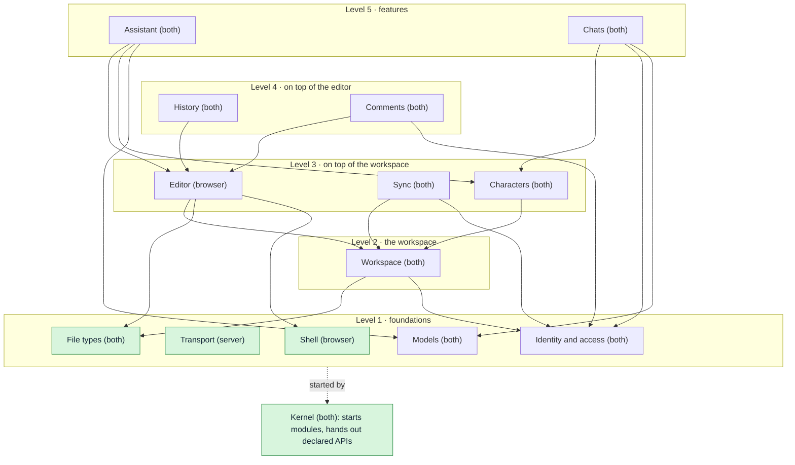
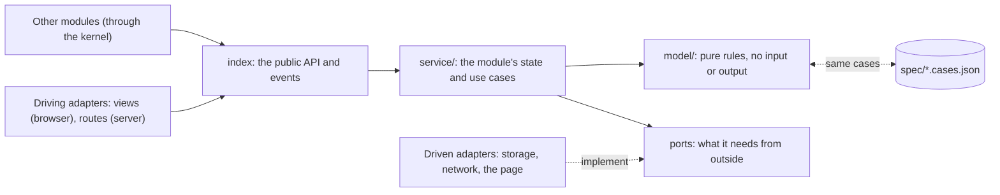
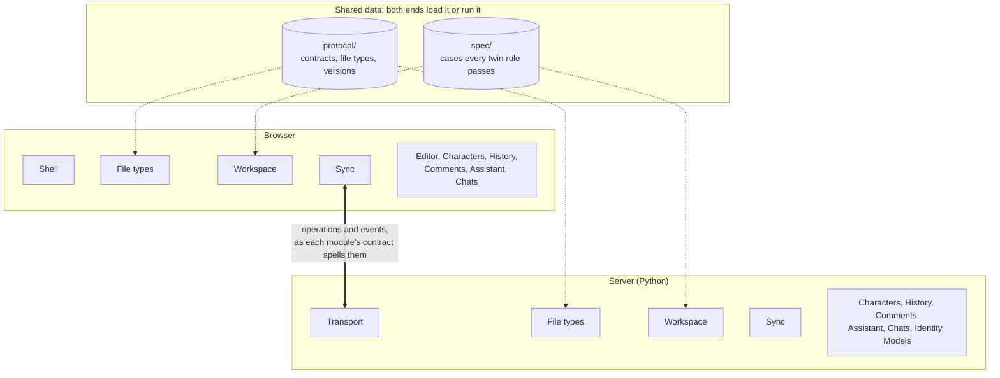
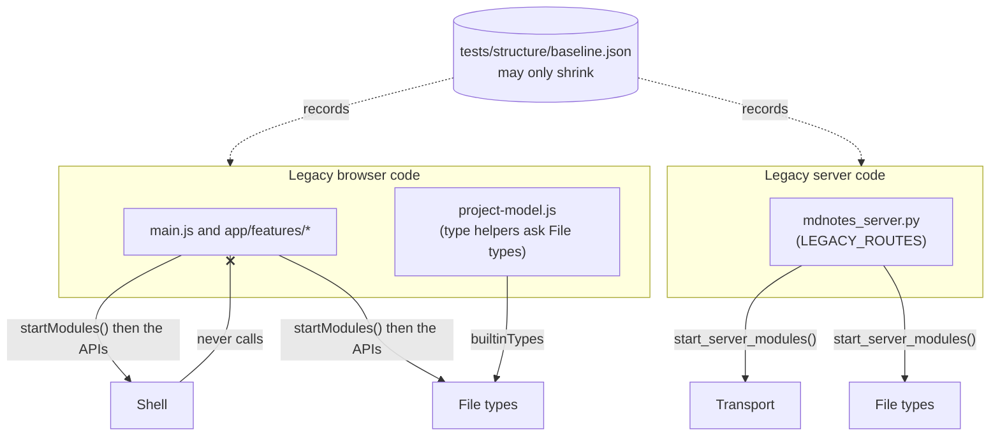
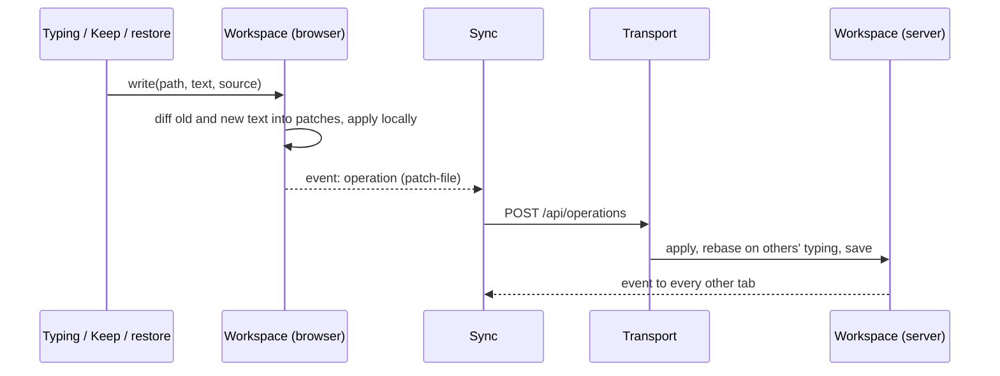

# Architecture

Stilo Marker is being restructured into a modular monolith on each end (decided
2026-10-16). The full design, with the reasoning, the module map and the order
of work, is in the "Module design" tab of the
[architecture review](https://claude.ai/code/artifact/ea78ba1f-1850-4b76-9642-8cffb14e6c7a).
This file is the short reference that the structure tests enforce.

## The shape

- **A tiny kernel** starts the modules in dependency order and hands each one
  only the public APIs it declared. It holds no state and knows no domain
  (`app/kernel/`, `server/stilo/kernel/`).
- **Modules in one-way levels** (`app/modules/`, `server/stilo/modules/`):

  | Level | Modules |
  | --- | --- |
  | 1 | Shell (browser) / Transport (server), Identity and access, File types, Models |
  | 2 | Workspace |
  | 3 | Editor (browser), Sync, Characters |
  | 4 | History, Comments |
  | 5 | Assistant, Chats |

- **Inside every module**: its definition (name, level, uses, owns: in a
  browser module the `defineModule({...})` its `index.js` exports, in a server
  module `module.json`), `index` (the public API and events), `model/` (pure
  rules), `service/` (state and use cases), `adapters/` (all input and output:
  views, routes, storage, network). Importing a browser module's `index.js`
  never touches the page; adapters reach the page only once started.
- **Between the ends**: each module's network messages live in
  `protocol/<module>.contract.json` with their own version. Until a module
  takes its share, everything is in `protocol/legacy.contract.json`.
- **Rules in both languages** (the server stays in Python) live only in a
  `model/` and share one case table in `spec/`, run by both test suites.

## Diagrams

### Modules and levels

Arrows are "uses": a module calls only the modules it points at, always on a
lower level. News travels the other way, as events or extension points, so it
needs no arrow. Green modules exist (as of v0.1.32); the rest are still legacy
code. Modules marked *both* have a browser half and a server half that share a
model and a contract.

### Inside a module

Every module has the same layers. Only the pure `model/` may exist in both
languages (with a shared case table in `spec/`); all input and output lives in
`adapters/`.

### The two ends

The same module names on both ends; the network is just an adapter pair. A
browser-only workspace runs the browser half alone. What both ends must agree
on is data, not code: `protocol/` (shapes, file types, versions) and `spec/`
(the cases every twin rule must pass).

### Legacy code during the move

Code from before the restructure (`app/main.js`, `app/features/`,
`mdnotes_server.py` and the rest) is not a module, so nothing may depend on
it. It may use modules, but only through the APIs the kernel hands back, or
through a module's static export such as `builtinTypes`. Each step moves a
piece across, and the baseline records what is left.

### The write path (step 4, planned)

Every change to a file becomes a `patch-file` operation, whoever makes it:
typing, the agent's Keep, preview edits, history restores and reconnects. The
agent stays a special collaborator: its edit arrives as a proposal and merges
like typing. Workspace never calls Sync (Sync sits above it): it emits each
operation as an event, and Sync sends it.

## The eight rules

`tests/structure/structure.test.mjs` checks each one.

1. Import another module only through its public API (`index.js`, `__init__.py`).
2. Use only modules listed in `uses`, all on a lower level; no cycles.
3. Calls go down, news goes up: call lower APIs; tell higher modules through
   events or extension points.
4. One owner per concept: each state, stored file, registry, network message
   and type name belongs to one module.
5. Input and output only in adapters; `model/` and `service/` never touch the
   DOM, `fetch`, files or SQLite.
6. Code in both languages lives only in a `model/`, with a case table in
   `spec/` (listed in `spec/twins.json`).
7. Each module owns its network messages and their version.
8. Size budgets: the kernel about 300 lines and free of domain words; any file 800.

## Legacy code

Code from before the restructure is not in a module yet. What it breaks today
is recorded in `tests/structure/baseline.json`: files over the size budget, and
the files that spell a type name the future owner will hold. The baseline may
only shrink. After a cleanup, `node tools/structure-baseline.mjs` lowers it; it
refuses to record anything new.

## Progress

| Step | What | State |
| --- | --- | --- |
| 1 | Guard rails: `tests/structure`, `spec/`, `protocol/legacy.contract.json` | done |
| 2 | Kernel (both ends), Shell (browser: commands, menus, shortcuts, dialogs), Transport (server: route table, CORS, JSON, error mapping) | done |
| 3 | File types: `protocol/file-types.json` on both ends; every type check in the browser and on the server asks it | done |
| 4 | Workspace, with the one write path | next |
| 5 | Characters (author's notes, update rules, hidden Plans) | |
| 6 | Assistant (`edit_file`) | |
| 7 | Sync, History, Comments, Identity, Models, Chats, Editor | |
| 8 | The URL album as an extension | |

### Notes for module authors

- Browser: a command id is `<owner>.<action>`; add it with
  `shell.commands.add({ id, title, run, keys?, menu? })`. Menus are drawn
  from commands, so `index.html` holds no menu items.
- Server: a new route is `transport.add_route(method, path, run)`, where
  `run(request)` returns the JSON payload and raises `PermissionError`,
  `LookupError` or `ValueError` for 403, 404 and 400. `KeyError` and
  `IndexError` stay 500: they are bugs. `LEGACY_ROUTES` in
  `mdnotes_server.py` holds the routes from before the restructure and only
  shrinks.
- File types: never spell an extension. Ask the module (`typeOf`, `is(name,
  id)`, `formatOf`, `extensionOf`, `mimeOf`...; code from before the
  restructure uses `builtinTypes` or the helpers in `project-model.js`). A new
  type is one entry in `protocol/file-types.json`, then
  `node tools/protocol-sync.mjs` writes the browser's copy. Pages mark what
  they need (`data-file-accept`, `data-file-types`, `data-file-type-options`)
  and File types fills it in.
