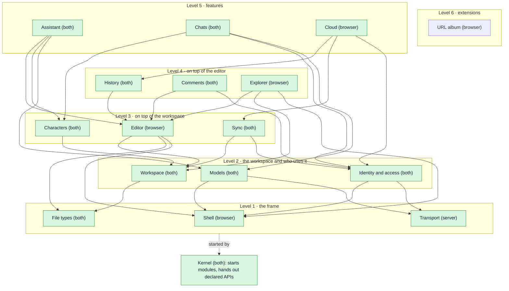
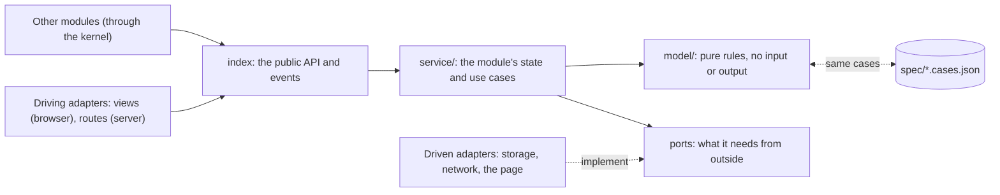
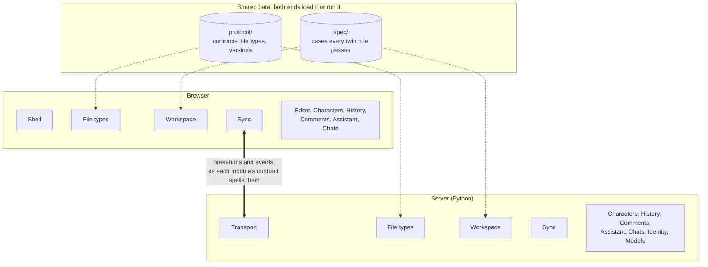
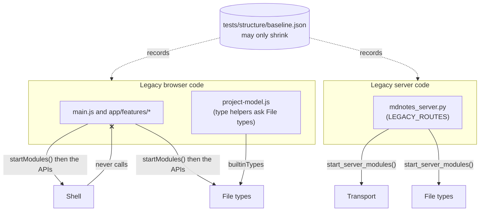
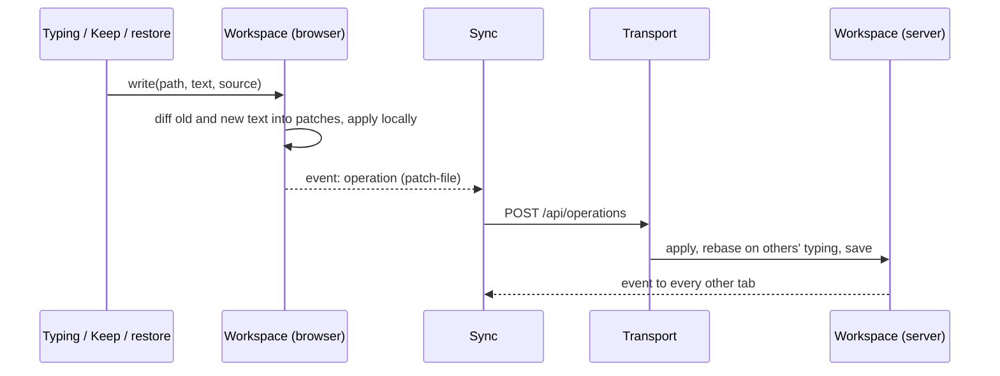

# Architecture

Stilo Marker is being restructured into a modular monolith on each end (decided
2026-10-16). The full design, with the reasoning, the module map and the order
of work, is in the "Module design" tab of the
[architecture review](https://claude.ai/code/artifact/ea78ba1f-1850-4b76-9642-8cffb14e6c7a).
This file is the short reference that the structure tests enforce.

## The shape

- **A tiny kernel** starts the modules in dependency order and hands each one
  only the public APIs it declared. It knows no domain (`app/kernel/`,
  `server/stilo/kernel/`). Its one piece of state is the browser's **trace**
  (see "Finding a bug" below).
- **Modules in one-way levels** (`app/modules/`, `server/stilo/modules/`):

  | Level | Modules |
  | --- | --- |
  | 1 | Shell (browser) / Transport (server), File types |
  | 2 | Workspace, Identity and access, Models |
  | 3 | Editor (browser), Sync, Characters |
  | 4 | History, Comments, Explorer (browser) |
  | 5 | Assistant, Chats, Cloud (browser) |
  | 6 | Extensions (`extensions/<name>/`): the URL album |

- **Inside every module**: its definition (name, level, uses, owns: in a
  browser module the `defineModule({...})` its `index.js` exports, in a server
  module `module.json`), `index` (the public API and events), `model/` (pure
  rules), `service/` (state and use cases), `adapters/` (all input and output:
  views, routes, storage, network). Importing a browser module's `index.js`
  never touches the page; adapters reach the page only once started.
- **Between the ends**: each module's network messages live in
  `protocol/<module>.contract.json` with their own version (Identity's was
  the first, in v0.1.38). Sync's version is the old single sync number (117):
  both ends read it from `protocol/sync.contract.json`, and other modules'
  events ride Sync's stream. What no module has taken yet is in
  `protocol/legacy.contract.json`.
- **Why Identity and Models sit on level 2** (changed 2026-10-17; the design
  had them on level 1): they need the frame below them, Transport for their
  routes on the server and Shell for the server connection and dialogs in the
  browser. Workspace does not need Identity (who may open a project is asked
  by the modules above it), so nothing else moved.
- **Rules in both languages** (the server stays in Python) live only in a
  `model/` and share one case table in `spec/`, run by both test suites.

## Diagrams

### Modules and levels

Arrows are "uses": a module calls only the modules it points at, always on a
lower level. News travels the other way, as events or extension points, so it
needs no arrow. Every module exists (as of v0.1.47) and the URL album is an
extension (v0.1.48); legacy code still wires the modules together. Modules marked *both* have a browser half and a server half that share a
model and a contract.

### Inside a module

Every module has the same layers. Only the pure `model/` may exist in both
languages (with a shared case table in `spec/`); all input and output lives in
`adapters/`.

### The two ends

The same module names on both ends; the network is just an adapter pair. A
browser-only workspace runs the browser half alone. What both ends must agree
on is data, not code: `protocol/` (shapes, file types, versions) and `spec/`
(the cases every twin rule must pass).

### Legacy code during the move

Code from before the restructure (`app/main.js`, `app/features/`,
`mdnotes_server.py` and the rest) is not a module, so nothing may depend on
it. It may use modules, but only through the APIs the kernel hands back, or
through a module's static export such as `builtinTypes`. Each step moves a
piece across, and the baseline records what is left.

### The write path (step 4, done in v0.1.33)

Every change to a file becomes a `patch-file` operation, whoever makes it:
typing, the agent's Keep, preview edits, history restores and reconnects. The
agent stays a special collaborator: its edit arrives as a proposal and merges
like typing. Workspace never calls Sync (Sync sits above it): it emits each
operation as an event, and Sync sends it.

## The ten rules

`tests/structure/structure.test.mjs` checks each one.

1. Import another module only through its public API (`index.js`, `__init__.py`).
   A browser module never imports code from before the restructure (`main.js`,
   `app/features`, `app/ui`, `app/services`, `app/domain`); that code may use
   modules, not the other way round.
2. Use only modules listed in `uses`, all on a lower level; no cycles.
3. Calls go down, news goes up: call lower APIs; tell higher modules through
   events or extension points.
4. One owner per concept: each state, stored file, registry, network message
   and type name belongs to one module.
5. Input and output only in adapters; `model/` and `service/` never touch the
   DOM, `fetch`, files or SQLite.
6. Code in both languages lives only in a `model/`, with a case table in
   `spec/` (listed in `spec/twins.json`).
7. Each module owns its network messages and their version.
8. Size budgets: the kernel about 300 lines and free of domain words; any file 800.
9. No catch swallows an error without a word: no empty `catch {}`, no
   `.catch(() => {})` (or `=> null`), no `except ...: pass`. Handle the error,
   or carry on with `ignore(error, "why")` from the kernel so it still reaches
   the trace (browser) or the server log.
10. No code writes another file's variables: no setter (`set name(value)`)
    in browser code. Shared state has one owner (`ctx.state(...)`, below) and
    changes through the owner's named actions. The getters `main.js` hands to
    the code it wires are counted in the baseline and may only shrink.

## Finding a bug: the trace

The browser's kernel keeps a trace of what happened lately, in order, and
who did it: every event a module emits, every listener that failed, every
error code chose to `ignore` (with its reason and file:line) and every error
nothing caught (Shell watches the page). A repeat is counted instead of pushing
older entries out.

- **See it:** the log panel's **Trace** tab (Settings, the log panel), or
  `stiloTrace()` in the browser console, which prints it and returns the
  entries. Copy and Clear work on the open tab.
- **Report into it:** `ignore(error, "why")` in a catch, `.catch(ignored("why"))`
  on a promise, `trace.record(kind, owner, message, detail)` for anything else
  (all from `app/kernel/index.js`). A module's `ctx.log(...)` lands there too.
- **The server:** `ignore(error, why)` from `stilo.kernel.log` writes an
  `[ignored]` line with where it happened; `best_effort(callback, why)` wraps a
  callback that must not stop its caller (progress down a stream), reporting
  its first failure once.

## Extensions

An extension is a folder under `extensions/` that adds a feature through the
modules' public extension points only. The URL album (step 8) is the first:
deleting `extensions/url-album/` and running `node tools/protocol-sync.mjs`
leaves an app that works without it.

- `extension.json`: `name`, `about`, `browser` (its browser module) and
  `fileTypes` (entries in the shape of `protocol/file-types.json`). Both ends
  merge these types after the built-in ones: the server's File types reads the
  manifests, and `tools/protocol-sync.mjs` writes the browser's copy, the list
  of modules `main.js` starts (`app/extensions.js`) and the files the service
  worker caches (`extensions/offline.js`).
- The browser module is a normal `defineModule` on level 6, above every core
  module. It imports only `app/kernel/index.js` and modules' `index.js`.
- The structure test fails if any code outside the extension's folder (the
  generated copies aside) spells its name or its file types' ids or labels.

## Legacy code

Code from before the restructure is not in a module yet. What it breaks today
is recorded in `tests/structure/baseline.json`: files over the size budget, and
the files that spell a type name the future owner will hold. The baseline may
only shrink. After a cleanup, `node tools/structure-baseline.mjs` lowers it; it
refuses to record anything new.

## Progress

| Step | What | State |
| --- | --- | --- |
| 1 | Guard rails: `tests/structure`, `spec/`, `protocol/legacy.contract.json` | done |
| 2 | Kernel (both ends), Shell (browser: commands, menus, shortcuts, dialogs), Transport (server: route table, CORS, JSON, error mapping) | done |
| 3 | File types: `protocol/file-types.json` on both ends; every type check in the browser and on the server asks it | done |
| 4 | Workspace, part 1: the one write path. Every text change travels as a patch; the agent is a collaborator (its edits merge, Drop undoes only its own) | done |
| 4b | Workspace, part 2: the project model and store (browser) and the tree, text offsets and folder storage (server) move into the module; operations get a shared case table | done |
| 4c | The server's operations (`_apply_operation`) and the sessions/sync parts of CollaborationBroker | done with 7c-1 |
| 5 | Characters on both ends: author's notes (hidden unless `notes: hints`), files characters cannot read (`Plans/`, `*.plan.md`), the agent's update rules and length guidance; every rule in one shared case table | done |
| 6 | Assistant on both ends: `edit_file` (exact passages, one match each, refused precisely so the model retries; proposals travel as an update-file with their edits and merge through the write path), the agent's tool definitions, the edit review card | done |
| 7a | Identity and access on both ends: accounts and the account file, sign-in tokens, who may open a project and in what role (`can(role, action)`), per-account preferences; in the browser the signed-in account and its stored sign-in. Shell gains the server connection. Identity's routes get the first module contract | done |
| 7b | Models: the providers (DeepSeek or another OpenAI-compatible endpoint, OpenAI, a user's own key), which models are offered and what each request carries, both streams (chat completions and the Responses API), image generation and generated images, MCP connections; in the browser a model called straight from the browser and the picker's grouping. A request gets an explicit route instead of provider fields on shared state | done |
| 7c-1 | Sync on the server: sessions and roles, presence, leases, event streams, the rebase log; every change checked against its revision before Workspace applies it. Workspace gains the pure `apply_operation`, the open project (`LiveProject`) and the one-file store. The last uncovered twin (rebasing a text patch) gets its case table. Dead code removed: revert-to-revision with its 40 project copies per workspace, the folder wipe | done |
| 7c-2 | Sync in the browser (the collaboration runtime, split into the runtime, the patch queue and pure rules; its server calls), Sync's routes on the server (Transport gained stream routes and refusals with a status), and `protocol/sync.contract.json` with the sync version both ends read. The backend self-test moved out of `mdnotes_server.py` into `tests/backend-selftest.py` | done |
| 7d | History on both ends: snapshots and backups in one content-addressed store each, their retention rules, the routes and `protocol/history.contract.json`; in the browser this browser's own snapshot store, History's server calls and the line diff (the dialogs stay in `app/features` and call it) | done |
| 7e | Comments on both ends: the rules for a line comment, the comments file it owns, its routes, contract and `comments` event; in the browser keeping a comment on its line (the gutter popover stays in `app/editor`) | done |
| 7f-1 | Chats on the server: the chat store (SQLite per project), who answers, the reply queue, claims for replies written in a member's own browser, its routes; a character's name comes from Characters' header rules (a fourth copy of them went) | done |
| 7f-2 | Chats in the browser (the chats view, this browser's own chat store, the server calls) and `protocol/chats.contract.json` with the chat events | done |
| 7g-1 | Editor (browser): the source editor, split by job into parts that share one editor object (text and DOM, rendering, edits and undo, others' cursors, the toolbar, keys), highlighting, find and replace, autocomplete, links, the formatting toolbar and table picker, and the Markdown renderer as its model. The gutter popover for comments moved into Comments. The URL album entry editing is a port the app provides (it becomes an extension in step 8) | done |
| 7g-2 | The tab strips and panes (and resuming the last view, through a port) and the preview pane with a `previews` extension point: images, Markdown and mind-map trees are built in; URL albums, diagrams and character sheets add theirs from `app/features/previews.js` | done |
| 8 | The URL album as an extension (v0.1.48): `extensions/url-album/` with its file type, model, preview, highlighting, Entry button and entry dialog. The core gained extension points instead of album code: file parts in Workspace (a file's named parts listed, opened, renamed, moved, copied and dropped on their own), highlighters and toolbars in Editor, `shell.form` for dialogs with several fields, and the Create menu drawn from File types. Nothing in the core names the album | done |

### Next: one owner per piece of state (decided 2026-10-18)

The module graph is clean, but `main.js` still holds the app's shared state
and hands it to the modules and features: on 2026-10-18, 261 live getters and
26 setters, and 149 functions that only forward a call. `selectionNodeId` was
written in 23 places in 4 files, `sourcePart` (the open album entry) in 12.
That is where bugs are hard to find. Steps, each its own release:

| Step | What | State |
| --- | --- | --- |
| S1 | The trace (kernel) and rule 9: every silent catch (57: 36 browser, 21 server) reports why it carries on | done (v0.1.52) |
| S2 | One owner per shared variable: the 26 that outside code set (v0.1.53: none left, rule 10). What the editor shows (tabs, the preview's file and part, the selection) is the Editor's `view`; shared or local work and the kept local project is Sync's `mode`; the rest moved into the one file that used them (gestures into layout, snapshot counts into snapshots, the replace target into file actions, MathJax loading into the preview, the editor's two flags into the editor). Getters handed out by `main.js`: 261 → 227 | done (v0.1.53) |
| S3a | The Editor owns all of itself (v0.1.54): it creates and wires its parts (source editor, highlighting, find, autocomplete, links, tabs and preview) instead of `main.js` creating six of them with their own lists of main's values; their state (undo history, search, autocomplete, render cache, dragged text, others' cursors, the file shown, resume positions), the editor's events, the resize observer and showing the active file moved in with them. `main.js` attaches one port (`editor.attach`, listed in `surface.js` as PORT) for what no module owns yet. Getters handed out by `main.js`: 227 → 133; `main.js` 4,539 → 3,731 lines | done (v0.1.54) |
| S3b | The Explorer module (v0.1.55, level 4): the tree, moving and copying files, folders and parts, adding files (and dropping them into the editor), creating, renaming, deleting, exporting, the context menu and its Edit / Create menu items, split by job into files under the budget. It uses Workspace, the Editor's `parts()` and Shell's dialogs; `main.js` attaches a port (16 names). The file-content and ZIP helpers moved into Workspace (shared with legacy saving); diagram export is `app/features/diagram-export.js` until diagrams become an extension. Rule 1 now fails on a module importing legacy code. Getters handed out by `main.js`: 133 → 90; `main.js` 3,731 → 3,328 lines | done (v0.1.55) |
| S3o-1 | Owners for what every legacy feature still needs, first: the settings (v0.1.56). Shell owns them; everyone holds a read-only view (`settings.theme`), changes go through `settings.change({ key: value }, why?)`, which saves only the changed keys (another tab's changes are never written back) and lands in the trace with the file and line that made it; secrets (the PIN, the stored password, an API key) are hidden there. A plain assignment throws. 64 writes in 5 files converted; `lastLocalProject` gained its missing default | done (v0.1.56) |
| S3o-2 | Sync owns the live session (v0.1.57): `sync.attach(port)` creates it, given what only the app can do (replace the project, apply a remote change, keep local edits before a reload, sign in again, upload an asset); its news are Sync's events (`status`, `remote-cursor`, `host-counters`, `patch-confirmed`, `event`). The session's status (connected, presence, role, what the server offers) is Sync's too: a live view everyone reads, changed by Sync from the session and by `status.change` where code pings or reconnects (23 direct writes in 2 files before). The Explorer asks Sync for the session instead of `main.js`. The settings' read-only view is now the kernel's `createLiveView`, used by both | done (v0.1.57) |
| S3o-3 | Workspace owns saving (v0.1.58): the four storage services moved into its adapters (this browser's copy, folders on disk, on-device folders, the save queue), and `workspace.saving` does what `main.js` did: the trailing browser copy flushed when the page may go away, a local project's folder, auto-save (idle and periodic) and Save. What only the app knows comes as hooks (`saving.attach({ busy, scope, shared, confirmed })`): an IME composition, the workspace a save belongs to, which files the server confirmed | done (v0.1.58) |
| S3o-4 | Drawing the app again is asked of Shell (v0.1.59): `shell.render(project, { only: "status" }?)` announces a `render` event that `main.js` answers; the Editor and the Explorer no longer carry `render` and `updateStatus` in their ports (Editor port 25 → 23 names, Explorer 16 → 13 since S3b). Splitting `main.js`'s render into each module's own listener is step 4 | done (v0.1.59) |
| S3c | The Cloud module (v0.1.60, level 5): signing in and out, the file browser (the server's teams and folders, this device's projects) and its two providers, deleting to the Trash, moving and copying, project access, hosting and publishing, opening a cloud workspace, and its dialogs' controls. The server's workspace routes (the legacy sync service) are its `api.js`; two unused calls were dropped. `main.js` attaches a port (12 names); the 967-line cloud browser is split by job. Getters handed out by `main.js`: 89 → 62; `main.js` 3,146 → 2,971 lines | done (v0.1.60) |
| S3d-1 | Pages in tab hosts (v0.1.61): Shell's `pages` make any place with a tab strip (`data-tab-host`) host features as pages, like a browser's tabs; a page has its own body, an optional "+" action and a badge, and never knows its neighbours. The side panel's Agent and Chats became two pages with separate bodies (each its own conversation, input, attachments and drops); the Chats page left `chat-panel.js` for `features/chats-page.js`, sharing only the agent's server connection, which it is given | done (v0.1.61) |
| S3d-2 | The agent's server connection is the Models module's (v0.1.62, `models.agent`): whether the server's agent is set up and why not, the models and the chosen one, what a request carries with the user's own key, the line in Settings → Agent; its rules are pure (`model/agent-status.js`). What a request carries from the project (its snapshot, the attached files) is Characters'. The Chats page now depends only on modules, and on the Agent page for the one-time move of old Roleplay threads. Also: 49 forwarders in `main.js` that nothing called any more were removed | done (v0.1.62) |
| S3d-3 | The Chats page is the Chats module's (v0.1.63, `adapters/page.js`, `chats.attach(port)`, 5 names): it registers its page in Shell's side host and draws itself; the Agent page hands it the old Roleplay threads once. On the way, the request to the server's agent became Models' (`sendChatRequest`) and the conversation helpers Shell's; `main.js` now starts Models, Characters and Chats | done (v0.1.63) |
| S3d-4a | The Agent page is the Assistant module's (v0.1.64, `assistant.load(port)`, loaded on first open): `adapters/panel.js` builds the page's shared context and the pieces are split by job (conversations, threads, render, turns, proposals, events), each a function of that context; its services came along (`api.js`, `store.js`, `workspace-sync.js`, `mcp.js`, `model/undo.js`). `app/features/chat-panel.js` is gone. The operation names are Workspace's constants (`UPDATE_FILE`, `PATCH_FILE`) | done (v0.1.64) |
| S3d-4b | The review of the agent's edits is the Assistant's (v0.1.65, `adapters/review.js`, `model/review.js`): which lines an applied edit changed, the checkpoints Drop restores deletes from, Keep / Drop / jump. It shows them through a new Editor extension point, `editor.marks` (tinted lines and gutter, a badge on the tab and the explorer row, a bar over the file), which the Explorer reads too; `agentPendingDecorations` and `updateEditorAgentBar` left the Editor's port and eight names left the Assistant's. `main.js` lost 180 lines | done (v0.1.65) |
| 5 | Areas (decided in principle 2026-10-18): the left, right and bottom areas are tab hosts (the activity bar an icon strip), Explorer, Linked Notes, Session, Agent, Chats and Log are pages, first in today's places, then movable between areas ("Move to…", then drag and drop) and remembered; the editor and preview stay in the middle; on a phone the areas fold into the pane carousel. The middle area too (decided 2026-10-18): editor groups, like VS Code's. A tab is a file and a view ("Open As…" Source / Preview / a file type's own view, from the explorer and the tab's menu); one group or two side by side, closing one makes the other the main one; today's Source | Preview is the default layout (linked scrolling kept when both show one file); the phone draws no tab strip (too cramped): it shows the focused file only, and its switch button changes that file's view in place (Source ↔ Preview in one tap, the "Open As…" list when a type has more views, hidden when there is one); files change from the explorer drawer and from the file name in the top bar (a list of the open files, from the start); on the phone each area is a drawer, as placed on the desktop: the left area a left drawer and the right area a right drawer (about 85% wide, the note peeking out; full width while typing), the bottom area a bottom sheet (half or full height, from a handle on the status bar); buttons open them, swipes only as an extra that starts inside the screen edge (the edges are the system's "back"); top bar: ≡ · file name ▾ · Source/Preview · right drawer; chat is a side-area page, not a view, so it keeps its own button. Phone and desktop share one state (the groups and tabs), so `mobileView`'s source/preview go. Staged: one source editor and one preview first, then several previews, two source editors only if wanted (the source editor is one element today) | |
| S4a-1 | Shell owns the Settings dialog (v0.1.66, `adapters/settings-dialog.js`): its sections are pages in a `settings` tab host, and a section's fields are declared by the module whose setting they change (`settingsDialog.fields.add`); Shell draws, binds and keeps them in step, and owners react to the setting changing, whoever changed it (the theme: Shell; the source font, word wrap, the formatting toolbar: the Editor; auto-save: Workspace). The dialog looks the same, pixel for pixel. `main.js` lost the dialog's tabs, ten handlers and the font picker | done (v0.1.66) |
| S4a-2 | Settings' other sections to their owners (v0.1.67): Agent is Models' (`adapters/settings-section.js`: where the key comes from, how characters' replies run, the status line drawn from the agent's connection, asking the server again when they or the server address change) with the Assistant's connected tools (drawn when Settings opens); Collaboration is Cloud's (the server address, reconnecting, display name, PIN). The Agent page now redraws when the agent's status changes instead of each caller redrawing it. `main.js` keeps the Collaboration buttons' work (Ping, Join) until S4c and the diagram's two settings until S4d | done (v0.1.67) |
| S4b | The status bar is Shell's (v0.1.68, `statusBar.add({ id, order, … })` → a handle to set its text, dot, title, visibility), and each item is its owner's, drawn from the owner's own state as it changes rather than on every redraw: where the project lives and folder access (Workspace, from the project), the server (Cloud, from Sync's status and the account), the collaborators and the Session panel (Sync), the character count (Editor), the snapshot version (`main.js` until S4d). A person's colour is Identity's (`participantColor`), shared by their cursor, dot and chip. Pixel-identical | done (v0.1.68) |
| S4c-1 | Sync owns the connection's life (v0.1.69, `adapters/connection.js`): joining a PIN session (Join, after the user agrees) and keeping it (auto-reconnect with backoff), what changes as the status does (the shared or own workspace, the in-step revision, reconnect toasts, a too-old app upgraded), switching between the shared workspace and the tab's own (`sync.switchMode`, the Session panel's switch), and sending a change (`sync.publish`: the base revision stamped, an image's bytes uploaded first, a refused write reloaded). Chats and the Agent page hear their own events on Sync's stream; the Assistant asks the agent again when a session connects or drops; the Explorer and Cloud call Sync directly. A deliberate switch to the tab's own workspace is announced (`"switched"`), so only that cancels an automatic resume | done (v0.1.69) |
| S4c-2 | Resuming and leaving (v0.1.70): Cloud resumes the last session (`adapters/resume.js`, `service/recovery.js`: at start, back on the page, back online, the welcome page's Resume; a deliberate switch to the tab's own workspace cancels it); Workspace reattaches the device folder when the project opens; when the page hides or goes, each module keeps its own part (the Editor where the reader was, Workspace this browser's copy and the unsaved-changes warning, Sync the in-step revision and leaving the session). `main.js` keeps one call to start the resume | done (v0.1.70) |
| S4d–S4e | Connecting and boot (Sync, Cloud); snapshots, the diagram's generate, the welcome screen (History, the diagram, Editor); the `elements` table, then `main.js` only starts the kernel | |
| S4 | `main.js` only starts the kernel; then the server's `WorkspaceRegistry` the same way | |

### Notes for module authors

- State other code needs to see: the owner makes it with `ctx.state(initial)`
  (kernel `createState`) and hands out `get()`, `on(listener)` and its own
  named actions, which call `set(action, patch)`. Each change is recorded in
  the trace with its action's name; lists in it are frozen, and a key it did
  not start with is refused. Never hand out a setter (rule 10).
- The editor's functions (insert at the caret, open a tab, the selection...):
  `editor.parts()` after `main.js` has called `editor.attach(port)`. A part
  needing something the Editor does not own gets it from the port; moving an
  entry out of PORT (to an owner, or an extension point) is how the port shrinks.
- The explorer's functions (the selected folder, creating a file in a folder,
  the context-menu actions): `explorer.parts()` after `explorer.attach(port)`.
- The live session: `sync.session()` (connect, publish, `isConnected()`...);
  its status `sync.status` (read-only; `status.change({...})` where you ping or
  reconnect); its news `sync.events.on("status" | "remote-cursor" |
  "host-counters" | "patch-confirmed" | "event", listener)`.
- A state others read but only its owner changes: `createLiveView(state)`
  (kernel) gives a read-only, always-current view with `change(patch, why?)`.
- Saving: `workspace.saving.schedule(project)` after a change,
  `saveActiveFile()`, `runAutoSave(why)`; the storage itself (loadProject,
  saveProject, folders) is Workspace's static API.
- A feature with its own page next to others (like a browser tab): give the
  host a tab strip (`data-tab-host="name"`, and a "+" button with
  `data-tab-host-new="name"`), then `shell.pages.add({ host, id, label, title,
  order, body, newItem?, shown?(visible) })`; `pages.badge(host, id, n)` shows
  a count. Shell remembers the open page per host (`settings.openPages`).
- Drawing the app again: `shell.render(project)` (or `{ only: "status" }` for
  the panes and status bar without the tree). Never call `main.js`'s render.
- The agent's connection: `models.agent` (`status()`, `refresh({ signedIn })`,
  `ensureReady`, `choose(model)`, `requestOverride()`); what a request carries
  from the project: Characters' `projectSnapshot(project)` and
  `contextFiles(project, { contextPaths })`.
- Settings: read `shell.settings.key`; change with `shell.settings.change({ key:
  value }, why?)` (a new key needs a default in Shell's `settings-store.js`);
  listen with `shell.settings.on((settings, changedKeys) => …)`.
- What the editor shows: `editor.view` (`get()` → `sourceOpenTabIds`,
  `previewOpenTabIds`, `previewFileId`, `previewPart`, `sourcePart`,
  `selectionNodeId`, `draggingTabState`; actions `reset`, `pick`, `select`,
  `openTab`, `closeTab`, `moveTab`, `showPreview`, `showDiff`, `clearParts`,
  `dragTab`, `keepTabs`). Shared or local work: `sync.mode` (`get()` →
  `workspaceMode`, `privateProject`; `share`, `leave`, `forgetKept`, `restore`).
- Browser: a command id is `<owner>.<action>`; add it with
  `shell.commands.add({ id, title, run, keys?, menu? })`. Menus are drawn
  from commands, so `index.html` holds no menu items.
- Server: a new route is `transport.add_route(method, path, run)`, where
  `run(request)` returns the JSON payload and raises `PermissionError`,
  `LookupError` or `ValueError` for 403, 404 and 400. `KeyError` and
  `IndexError` stay 500: they are bugs. `LEGACY_ROUTES` in
  `mdnotes_server.py` holds the routes from before the restructure and only
  shrinks.
- File types: never spell an extension. Ask the module (`typeOf`, `is(name,
  id)`, `formatOf`, `extensionOf`, `mimeOf`...; code from before the
  restructure uses `builtinTypes` or the helpers in `project-model.js`). A new
  type is one entry in `protocol/file-types.json`, then
  `node tools/protocol-sync.mjs` writes the browser's copy. Pages mark what
  they need (`data-file-accept`, `data-file-types`, `data-file-type-options`)
  and File types fills it in.
- The server, from the browser: `shell.server.request(path, { method, query,
  body, failure })`. Never build the address yourself; `shell.server.url()`
  is it. Each module's calls live in its `adapters/api.js`.
- The signed-in account: `identity.account()` (`{ token, username, teams }`
  or null) and `identity.token()`; listen to `identity.events.on("account")`.
  Never read the stored password or the sign-in settings: Identity keeps them.
  On the server, `identity.require(token)`, `require_team`, `may_open`,
  `role` and `can(identity, action, team, access)`.
- Calling a model (server): `route = providers.route(model, own_key,
  own_url, own_model)`, then `providers.stream(route, payload, emit)` (or
  `complete`). Build the payload in chat-completions form; Models adds what
  the model needs and translates it for the Responses API. In the agent the
  seam is `ChatProxy._complete(payload, emit)`, which tests fake. From the
  browser to a user's own endpoint: `runDirectReply` (Models).
- Changing a shared workspace (server): `SharedWorkspace.apply_operation(token,
  operation)` (Sync) checks the sender's role and the revision, rebases a
  text patch, then calls Workspace's `apply_operation(project, operation,
  types)`, which only changes the tree. Operation names are Workspace's
  (`PATCH_FILE`, `UPDATE_FILE`, `REPLACE_PROJECT`); the paths an operation
  touches are `touched_paths(operation)`.
- Server routes that answer with their own status: raise
  `transport.Refusal(status, payload)` (Sync's 409 conflicts, 426 out-of-date
  tabs, 503 storage). A server-sent event stream is
  `transport.add_stream_route(method, path, run)`.
- Events of your own on the live stream: the server broadcasts through the
  shared workspace; in the browser, Sync hands every event it does not own to
  the runtime's `onEvent(event, { ownClientId })`.
- A preview for a kind of file: `editor.previews.add({ id, matches(file),
  render(target, project, file, tools), cacheable?, printHtml? })`;
  `tools.markdownHtml(project, file, text)` renders Markdown with the
  project's links and images. A cacheable preview is a pure function of the
  file's text, the project's paths and the connection.
- A file whose text holds named parts (each listed under the file in the
  explorer, opened in the source editor on its own, renamed, deleted, copied,
  dragged between files and dropped into Markdown):
  `workspace.parts.add({ id: <file type id>, list, body, withBody, rename,
  remove, take, insert, linkText?, add? })` (the shapes are in Workspace's
  `index.js`). The explorer, tabs and file actions do the rest.
- Highlighting and toolbar buttons for a format the Editor does not know:
  `editor.highlighters.add({ id: format, line(rawLine, { escape, blank }) })`
  and `editor.toolbars.add({ id: format, groups })` (groups as in
  `TOOLBAR_SPECS`).
- An item in the status bar: `shell.statusBar.add({ id, order, title?,
  action?, dot?, grow?, hidden? })` returns `{ set({ text, tone, title,
  hidden }), element, extra }`; draw it from your own state when that changes.
- A setting in the Settings dialog: `shell.settingsDialog.fields.add({ page,
  id, order, label, key, control: "select" | "checkbox", options?, read?,
  write? })`, or `{ page, id, order, render(box) }` for a field you draw;
  react to the setting with `shell.settings.on((view, changed) => …)`, not to
  the control. A new section: `settingsDialog.addPage({ id, label, order,
  body })` with a `[data-settings-fields]` box in the body.
- Marking a file's lines for review (the agent's applied edits do this):
  `editor.marks.put({ [path]: { owner, kind, lineStart, lineEnd, title?,
  bar?() } }, why)` tints those lines and the gutter (`is-<kind>`), badges
  the file's tab and explorer row, and shows `bar()`'s HTML over the editor
  while the file is open; `editor.marks.remove((mark, path) => …, why)` takes
  them off; `editor.parts().revealMark(path)` opens the file at its first
  marked line. Style `is-<kind>` in the stylesheet.
- A dialog that asks for several values: `shell.form({ eyebrow, title,
  message, fields: [{ name, label, value, type, multiline, placeholder }] })`
  resolves to `{ name: value }` or null.
- A new kind of file that can be created (New ... in the Create menu and the
  explorer): give its File types entry a `create: { label, name, order }`.
- Deleting a cloud project or folder: `registry.delete_entry` moves it, with
  its history, into History's trash (`history.trash.put`). The trash keeps it
  for `--trash-days` (at most 30) and the backup sweep removes it after
  that. Who may delete or restore is `identity.may_delete(identity, team,
  folder)`. In the browser, `modules.history.trash.open(team, { onChange })`
  shows it.
- A module's network messages: list each route in
  `protocol/<module>.contract.json`. The structure test checks that the
  server half serves exactly those and that nothing outside the module calls
  them.
- Writing a file: never send `update-file` for text and never call
  `controller.updateContent` plus `publishOperation` yourself. Call
  `workspace.write(path, text, { base?, source })`. With `base` (the text you
  started from) your change is fitted into the file as it is now; a
  `StaleWriteError` (`workspace.isStale(error)`) means it no longer fits and
  nothing changed. A restore that chains on the server's confirmation uses
  `workspace.asPatch(operation, revision)`.
