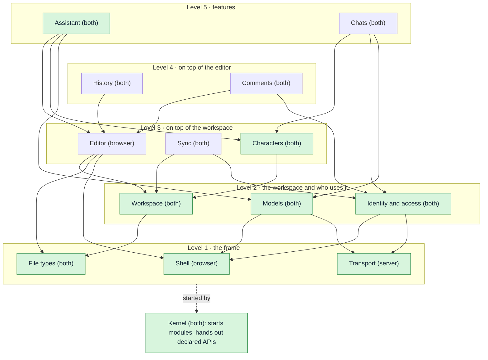
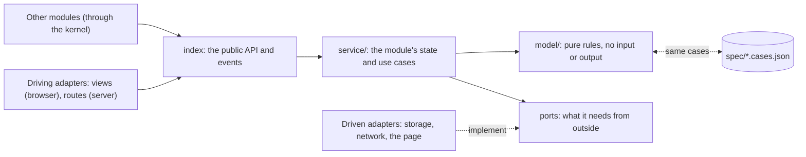
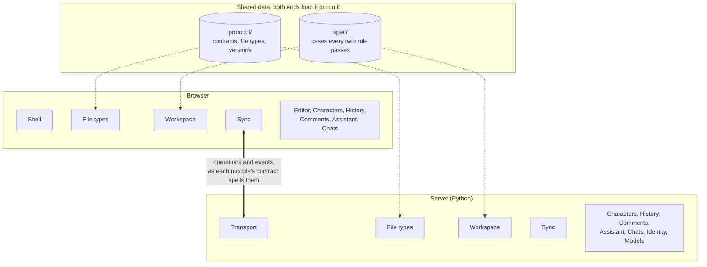
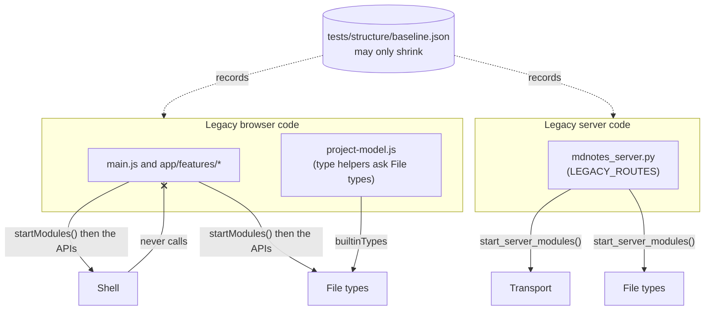
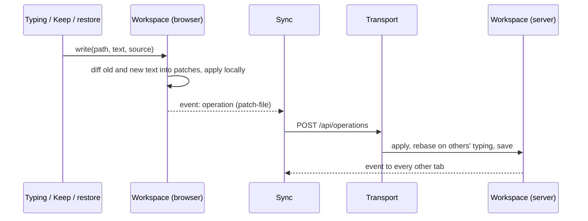

# Architecture

Stilo Marker is being restructured into a modular monolith on each end (decided
2026-10-16). The full design, with the reasoning, the module map and the order
of work, is in the "Module design" tab of the
[architecture review](https://claude.ai/code/artifact/ea78ba1f-1850-4b76-9642-8cffb14e6c7a).
This file is the short reference that the structure tests enforce.

## The shape

- **A tiny kernel** starts the modules in dependency order and hands each one
  only the public APIs it declared. It holds no state and knows no domain
  (`app/kernel/`, `server/stilo/kernel/`).
- **Modules in one-way levels** (`app/modules/`, `server/stilo/modules/`):

  | Level | Modules |
  | --- | --- |
  | 1 | Shell (browser) / Transport (server), File types |
  | 2 | Workspace, Identity and access, Models |
  | 3 | Editor (browser), Sync, Characters |
  | 4 | History, Comments |
  | 5 | Assistant, Chats |

- **Inside every module**: its definition (name, level, uses, owns: in a
  browser module the `defineModule({...})` its `index.js` exports, in a server
  module `module.json`), `index` (the public API and events), `model/` (pure
  rules), `service/` (state and use cases), `adapters/` (all input and output:
  views, routes, storage, network). Importing a browser module's `index.js`
  never touches the page; adapters reach the page only once started.
- **Between the ends**: each module's network messages live in
  `protocol/<module>.contract.json` with their own version (Identity's was
  the first, in v0.1.38). Until a module takes its share, everything is in
  `protocol/legacy.contract.json`.
- **Why Identity and Models sit on level 2** (changed 2026-10-17; the design
  had them on level 1): they need the frame below them, Transport for their
  routes on the server and Shell for the server connection and dialogs in the
  browser. Workspace does not need Identity (who may open a project is asked
  by the modules above it), so nothing else moved.
- **Rules in both languages** (the server stays in Python) live only in a
  `model/` and share one case table in `spec/`, run by both test suites.

## Diagrams

### Modules and levels

Arrows are "uses": a module calls only the modules it points at, always on a
lower level. News travels the other way, as events or extension points, so it
needs no arrow. Green modules exist (as of v0.1.39); the rest are still legacy
code. Modules marked *both* have a browser half and a server half that share a
model and a contract.

### Inside a module

Every module has the same layers. Only the pure `model/` may exist in both
languages (with a shared case table in `spec/`); all input and output lives in
`adapters/`.

### The two ends

The same module names on both ends; the network is just an adapter pair. A
browser-only workspace runs the browser half alone. What both ends must agree
on is data, not code: `protocol/` (shapes, file types, versions) and `spec/`
(the cases every twin rule must pass).

### Legacy code during the move

Code from before the restructure (`app/main.js`, `app/features/`,
`mdnotes_server.py` and the rest) is not a module, so nothing may depend on
it. It may use modules, but only through the APIs the kernel hands back, or
through a module's static export such as `builtinTypes`. Each step moves a
piece across, and the baseline records what is left.

### The write path (step 4, done in v0.1.33)

Every change to a file becomes a `patch-file` operation, whoever makes it:
typing, the agent's Keep, preview edits, history restores and reconnects. The
agent stays a special collaborator: its edit arrives as a proposal and merges
like typing. Workspace never calls Sync (Sync sits above it): it emits each
operation as an event, and Sync sends it.

## The eight rules

`tests/structure/structure.test.mjs` checks each one.

1. Import another module only through its public API (`index.js`, `__init__.py`).
2. Use only modules listed in `uses`, all on a lower level; no cycles.
3. Calls go down, news goes up: call lower APIs; tell higher modules through
   events or extension points.
4. One owner per concept: each state, stored file, registry, network message
   and type name belongs to one module.
5. Input and output only in adapters; `model/` and `service/` never touch the
   DOM, `fetch`, files or SQLite.
6. Code in both languages lives only in a `model/`, with a case table in
   `spec/` (listed in `spec/twins.json`).
7. Each module owns its network messages and their version.
8. Size budgets: the kernel about 300 lines and free of domain words; any file 800.

## Legacy code

Code from before the restructure is not in a module yet. What it breaks today
is recorded in `tests/structure/baseline.json`: files over the size budget, and
the files that spell a type name the future owner will hold. The baseline may
only shrink. After a cleanup, `node tools/structure-baseline.mjs` lowers it; it
refuses to record anything new.

## Progress

| Step | What | State |
| --- | --- | --- |
| 1 | Guard rails: `tests/structure`, `spec/`, `protocol/legacy.contract.json` | done |
| 2 | Kernel (both ends), Shell (browser: commands, menus, shortcuts, dialogs), Transport (server: route table, CORS, JSON, error mapping) | done |
| 3 | File types: `protocol/file-types.json` on both ends; every type check in the browser and on the server asks it | done |
| 4 | Workspace, part 1: the one write path. Every text change travels as a patch; the agent is a collaborator (its edits merge, Drop undoes only its own) | done |
| 4b | Workspace, part 2: the project model and store (browser) and the tree, text offsets and folder storage (server) move into the module; operations get a shared case table | done |
| 4c | The server's operations (`_apply_operation`) and the sessions/sync parts of CollaborationBroker | with step 7 (Sync) |
| 5 | Characters on both ends: author's notes (hidden unless `notes: hints`), files characters cannot read (`Plans/`, `*.plan.md`), the agent's update rules and length guidance; every rule in one shared case table | done |
| 6 | Assistant on both ends: `edit_file` (exact passages, one match each, refused precisely so the model retries; proposals travel as an update-file with their edits and merge through the write path), the agent's tool definitions, the edit review card | done |
| 7a | Identity and access on both ends: accounts and the account file, sign-in tokens, who may open a project and in what role (`can(role, action)`), per-account preferences; in the browser the signed-in account and its stored sign-in. Shell gains the server connection. Identity's routes get the first module contract | done |
| 7b | Models: the providers (DeepSeek or another OpenAI-compatible endpoint, OpenAI, a user's own key), which models are offered and what each request carries, both streams (chat completions and the Responses API), image generation and generated images, MCP connections; in the browser a model called straight from the browser and the picker's grouping. A request gets an explicit route instead of provider fields on shared state | done |
| 7c | Sync: sessions, presence, leases, the event stream, reconnect; the server's operations (`_apply_operation`, from 4c); a sync contract and version in place of 117 | next |
| 7d | History: snapshots, backups, restore (through `write`) | |
| 7e | Comments: line comments and their anchors | |
| 7f | Chats: conversations, members, notes, search, the reply queue | |
| 7g | Editor (browser): the source editor, preview, tabs within panes, find and replace | |
| 8 | The URL album as an extension | |

### Notes for module authors

- Browser: a command id is `<owner>.<action>`; add it with
  `shell.commands.add({ id, title, run, keys?, menu? })`. Menus are drawn
  from commands, so `index.html` holds no menu items.
- Server: a new route is `transport.add_route(method, path, run)`, where
  `run(request)` returns the JSON payload and raises `PermissionError`,
  `LookupError` or `ValueError` for 403, 404 and 400. `KeyError` and
  `IndexError` stay 500: they are bugs. `LEGACY_ROUTES` in
  `mdnotes_server.py` holds the routes from before the restructure and only
  shrinks.
- File types: never spell an extension. Ask the module (`typeOf`, `is(name,
  id)`, `formatOf`, `extensionOf`, `mimeOf`...; code from before the
  restructure uses `builtinTypes` or the helpers in `project-model.js`). A new
  type is one entry in `protocol/file-types.json`, then
  `node tools/protocol-sync.mjs` writes the browser's copy. Pages mark what
  they need (`data-file-accept`, `data-file-types`, `data-file-type-options`)
  and File types fills it in.
- The server, from the browser: `shell.server.request(path, { method, query,
  body, failure })`. Never build the address yourself; `shell.server.url()`
  is it. Each module's calls live in its `adapters/api.js`.
- The signed-in account: `identity.account()` (`{ token, username, teams }`
  or null) and `identity.token()`; listen to `identity.events.on("account")`.
  Never read the stored password or the sign-in settings: Identity keeps them.
  On the server, `identity.require(token)`, `require_team`, `may_open`,
  `role` and `can(identity, action, team, access)`.
- Calling a model (server): `route = providers.route(model, own_key,
  own_url, own_model)`, then `providers.stream(route, payload, emit)` (or
  `complete`). Build the payload in chat-completions form; Models adds what
  the model needs and translates it for the Responses API. In the agent the
  seam is `ChatProxy._complete(payload, emit)`, which tests fake. From the
  browser to a user's own endpoint: `runDirectReply` (Models).
- A module's network messages: list each route in
  `protocol/<module>.contract.json`. The structure test checks that the
  server half serves exactly those and that nothing outside the module calls
  them.
- Writing a file: never send `update-file` for text and never call
  `controller.updateContent` plus `publishOperation` yourself. Call
  `workspace.write(path, text, { base?, source })`. With `base` (the text you
  started from) your change is fitted into the file as it is now; a
  `StaleWriteError` (`workspace.isStale(error)`) means it no longer fits and
  nothing changed. A restore that chains on the server's confirmation uses
  `workspace.asPatch(operation, revision)`.
