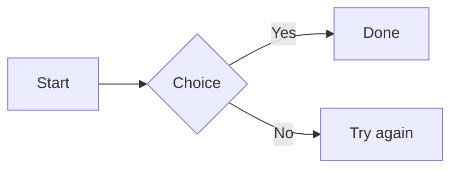

# Stilo Marker — User Manual

Stilo Marker is a browser-based Markdown workspace. It lets you write notes, build module-map diagrams, manage image URL albums, draw brainstorm diagrams, and organize everything in a file explorer—all in a single-page app with no build step.

---

## Table of Contents

1. [Application Layout](#1-application-layout)
2. [Project Model](#2-project-model)
3. [Markdown Files (.md)](#3-markdown-files-md)
4. [Module-Map Files (.mtree)](#4-module-map-files-mtree)
5. [URL Album Files (.urldb)](#5-url-album-files-urldb)
6. [Brainstorm Diagram Files (.bmap)](#6-brainstorm-diagram-files-bmap)
7. [Mermaid Diagrams (.mmd)](#7-mermaid-diagrams-mmd)
8. [HTML Pages (.html)](#8-html-pages-html)
9. [Text and Data Files (.txt, .log, .json, .csv, .tsv)](#9-text-and-data-files-txt-log-json-csv-tsv)
10. [Image Files](#10-image-files)
11. [Explorer](#11-explorer)
12. [Source Pane](#12-source-pane)
13. [Preview Pane](#13-preview-pane)
14. [Saving and Exporting](#14-saving-and-exporting)
15. [Collaboration Backend](#15-collaboration-backend)
16. [Chat Panel](#16-chat-panel)
17. [Settings](#17-settings)
18. [Templates](#18-templates)

---

## 1. Application Layout

```
┌─────────────────────────────────────────────────────────┐
│  Menu bar: File | Create | View | Settings | ...        │
├──────────┬──────────────────────┬────────────┬──────────┤
│ Explorer │   Source pane        │  Preview   │  Chat    │
│          │   (editor)           │  pane      │  panel   │
│          │                      │            │          │
├──────────┴──────────────────────┴────────────┴──────────┤
│  Status bar                                             │
└─────────────────────────────────────────────────────────┘
```

- **Explorer** — tree of folders and files in the current project: the first tab of the left window, whose icons are in the activity bar at the far left (the Explorer, Search, and any panel moved there; click the icon of the tab showing to hide the window).
- **Source pane** — text editor for the active file; also shows image previews.
- **Preview pane** — rendered output (HTML for Markdown, SVG tree for MTREE, album grid for URLDB, interactive canvas for BMAP).
- **Chat panel** — the right panel (Agent, Chats): AI assistant wired to the backend chat proxy; the button at the right end of the top bar shows or hides it.
- **Status bar** — where the project lives, the server's state, collaborators
  online and the open file's version (each once there is something to show),
  and the file's length.

Panels can be toggled from the `View` menu.

### The Log and its command line

The Log (View → Toggle Log) lists what the app did. Under it is a command
line: type part of a command's name and pick it from the suggestions (↑ ↓ to
choose, Enter to run, Tab to complete, Esc to close). With nothing typed it
lists every command. `View → Run Command…` (`F1`) opens the Log with the
line ready; `help` lists the commands in the Log. Any menu command can be
run there.

**If the app seems stuck**, run **Reload Window** (also in the Settings
menu). It is the browser's reload without losing work: it first waits for
your typing in a shared workspace to reach the server, writes your files to
this browser (and to a local project's folder), and keeps the open tabs and
the caret; then it reloads, without the browser's "Leave site?" question.
If something can't be kept (the server is unreachable, a folder on disk has
unsaved files, the Agent is still answering), it says what and asks before
reloading.

**Installing it.** Browsers that offer it (Chrome and Edge: the install
button in the address bar; Safari on iPhone and iPad: Share → Add to Home
Screen) install the app in a window of its own; it opens without the
internet too. A new version doesn't change an open window under you: the
status bar says **Update ready**, and Reload Window (or clicking it) starts
it, keeping your work; other windows of the app follow. Closing every window
of the app starts it too (the browser's own reload keeps the version).

**The desktop app** (`desktop/`, see its README) is the same app in a window
of its own, with no server needed. Closing it with unsaved work asks first;
links open in your browser; a newer release shows "Update available" in the
status bar, which opens its download page. The app's top bar is the window's title bar: drag it to
move the window; the window's buttons are at its right end (on a Mac, its
left). Zoom with Ctrl+= / Ctrl+- /
Ctrl+0 (Cmd on a Mac), Ctrl+wheel, or View → Zoom In / Zoom Out / Reset
Zoom; the status bar shows the zoom while it is not 100% (click it for
100%), and the app keeps it for next time.

**Settings → Server** (the desktop app): run a server on this computer, or
connect to another one (yours, at its address), or none. Running, it says
where other devices open it (in their browser) and the PIN they join with;
**Share This Workspace** makes your workspace the one they join. The app
remembers: next time it starts the server again and gets back on it by
itself. Running a server here needs Python 3.10 or later.

That server takes PINs only until **Turn On Accounts…** (under it): you name
its first admin and a password (at least 8 characters), the app makes the
account and signs you in as it. From then on others sign in with accounts
the admin adds in **Settings → Accounts**. There is no default account or
password; turning accounts on is offered only while there are none.

---

## 2. Project Model

A **project** is an in-memory tree of nodes. Each node is either a **folder** or a **file**.

```
project
  id            string   — unique project identifier
  name          string   — display name shown in the title bar
  sourceMode    string   — "memory" | "opfs" | "directory"
  rootId        string   — ID of the root folder node
  activeFileId  string?  — ID of the currently open file
  nodes         object   — map of nodeId → Node
```

A **node**:

```
node
  id            string   — unique within the project
  kind          "folder" | "file"
  name          string   — filename or folder name (e.g. "notes.md")
  parentId      string?  — null for the root folder
  children      string[] — (folders only) ordered list of child node IDs
  expanded      boolean  — (folders only) whether the folder is open in the explorer
  content       string   — (files only) full text content of the file
  dirty         boolean  — (files only) true if unsaved changes exist
  sourceVersion number   — (files only) monotonically increasing edit counter
```

The file type is determined purely by the file extension (`.md`, `.mtree`, `.urldb`, `.bmap`, `.mmd`, `.html`, or an image extension).

**Source modes:**

| Mode | Description |
|------|-------------|
| `memory` | Entire project lives in browser `localStorage`. |
| `opfs` | Uses the browser Origin Private File System (Chromium). |
| `directory` | Backed by a real directory on disk via the File System Access API (Chromium only). |

---

## 3. Markdown Files (.md)

Standard CommonMark-ish Markdown with a few extensions.

**Supported syntax:**
- Headings `# H1` through `###### H6`
- Bold `**text**`, italic `*text*`, strikethrough `~~text~~`, inline code `` `code` ``
- Fenced code blocks with optional language tag ` ```lang `
- Lists: `- item` (or `*`, `+`), numbered `1. item` or `1) item` (counting
  from the first number), nested by indenting the item, task lists
  `- [ ] item` / `- [x] item`
- Blockquotes `> text`
- Tables `| col | col |`
- Horizontal rules `---` (or `***`, `___`)
- Links `[label](url)` and reference-style links
- Images `` and reference-style images
- HTML pass-through (inline tags and comments are preserved)
- Footnotes `[^label]` / `[^label]: text` (a number in the text, its note on
  hover, and the notes listed at the end of the preview)

**Preview:** The preview pane renders Markdown to HTML with syntax-highlighted code blocks.

**Editing tips:**
- `Enter` on a list item continues the list; `Enter` on an empty item exits.
- `Tab` / `Shift+Tab` indents/unindents list items.
- `Ctrl+S` / `Cmd+S` saves.

---

## 4. Module-Map Files (.mtree)

`.mtree` files describe directed graphs of named modules using an indented outline syntax. They are used to visualize hierarchies, dependency maps, or relationship trees.

### Basic syntax

```
ParentModule
    ChildA
    ChildB; optional inline description
        GrandchildA
```

- **Indentation** defines the parent–child relationship. Use one tab **or** 4 spaces per level. Do not mix tabs and spaces.
- A **semicolon** `;` separates the module name from its description: `Name; Description text`.
- Lines starting with `#` are comments.
- Blank lines reset the current definition block context.

### Pipe continuation `|`

Additional description lines can follow a module using `|`:

```
MyModule; first line of description
| second line
| third line
```

### Definition blocks `[Name]`

A definition block lets you write a multi-line description for a module anywhere in the file:

```
[MyModule]
This is a longer description.
It can span multiple lines.
| Pipe prefix is optional inside definition blocks.
```

### Arrow chains `->`

Use `->` to declare a chain of relationships on a single line:

```
A -> B -> C; description for C
```

This is equivalent to:

```
A
    B
        C; description for C
```

### Continuation token `...`

`...` signals that children declared below should be treated as roots in a separate continuation tree rather than children of the previous module. This is used to split large trees across sections.

```
ParentA
    Child1
    Child2

...

ParentB
    Child3
```

With `...->TargetModule`, the subtree starting at `TargetModule` is injected as a continuation:

```
... -> TargetModule
    ExtraChild
```

### Render flags

The preview renderer accepts two boolean render flags (displayed in the preview pane header):

| Flag | Name | Effect |
|------|------|--------|
| `T` / `F` | Simplify | Collapse single-child chains into one connector |
| `T` / `F` | Split continuations | Render each continuation tree as a separate diagram |

Default flags: `TT`.

### Preview rendering

The MTREE preview renders the graph as an SVG tree diagram. Nodes show their name and (if present) description. Arrows indicate parent→child direction. If a node has multiple parents, it appears in all relevant subtrees.

---

## 5. URL Album Files (.urldb)

`.urldb` files store ordered collections of image URL bookmarks. They are used as lightweight image reference albums.

### File format

```ini
# Comments start with #

[Entry Name]
url = https://example.com/image.jpg
description = Optional human-readable description

[Another Entry]
url = https://example.com/other.png
```

- Each entry starts with a `[Name]` header.
- `url` is required. `description` is optional.
- Entries are ordered as they appear in the file.
- Backslash escapes: `\\` for a literal backslash, `\n` for a newline inside a value.

### Explorer behavior

URL album entries appear as children of the `.urldb` file node in the explorer. Each entry has its own icon. Entries can be:

- Clicked to open an image preview.
- Dragged to reorder within the same album.
- Dragged to a different `.urldb` file to move or copy them.
- Added via the explorer context menu ("Add Album Entry").
- Copied and pasted between albums.

### Preview

The URLDB preview renders all entries as a clickable image grid. Clicking an entry opens a larger preview.

---

## 6. Brainstorm Diagram Files (.bmap)

`.bmap` files store interactive node-and-connector brainstorm diagrams. The format is a CSS-inspired block syntax.

### File format

```
.node {
  id: node1
  name: My Node
  text: Optional body text
  shape: rect
  pos: {x: 120, y: 80}
  file: path/to/linked.md
  styles: {
    background: #fffbe6
    border: 1px solid #e8b339
    border-radius: 8px
    width: 220
    height: 90
  }
}

.connect {
  from: node1.right.0
  to: node2.left.0
  styles: {
    mode: bezier
    arrow: end
    dashed: false
    thickness: 2
    color: #1677ff
  }
}
```

### Node properties

| Property | Type | Description |
|----------|------|-------------|
| `id` | string | Unique node identifier within the diagram |
| `name` | string | Label shown on the node |
| `text` | string | Optional sub-label or body text (supports `\n`) |
| `shape` | `rect` \| `circle` | Visual shape |
| `pos` | `{x, y}` | Canvas position in pixels |
| `file` | path string | Optional link to another file in the project |
| `styles` | object | Visual overrides (see below) |

**Default styles for `rect`:** yellow background, gold border, 8px radius, 220×90 px.  
**Default styles for `circle`:** green background, green border, 160×160 px.

### Connector properties

| Property | Type | Default | Description |
|----------|------|---------|-------------|
| `from` | `nodeId.side.N` | — | Source snap point |
| `to` | `nodeId.side.N` | — | Target snap point |
| `mode` | `bezier` \| `straight` | `bezier` | Line shape |
| `arrow` | `end` \| `start` \| `both` \| `none` | `end` | Arrow direction |
| `dashed` | `true` \| `false` | `false` | Dashed line |
| `thickness` | integer | `2` | Stroke width in pixels |
| `color` | hex color | `#1677ff` | Stroke color |

**Snap point syntax:** `nodeId.side.N`  
Side indices: `0` = top, `1` = right, `2` = bottom, `3` = left.  
`N` is the snap slot index along that side (for multiple connectors).

### Interactive canvas

In the preview pane the diagram is rendered as an interactive SVG/HTML canvas:
- Drag nodes to reposition them.
- Click a node with a linked `file` to open a popup showing that file's content.
- The canvas auto-saves changes back to the `.bmap` source.
- In edit mode (✎), selecting a node or connector opens the inspector over
  the diagram's right side (on a phone, under it); its × folds it to a tab
  at the edge and Escape closes it. ? shows the editing tips.
- Opened, a diagram fits its pane (zoomed out to at most 50%; a bigger one
  shows its top-left part), and keeps fitting as the pane resizes until you
  pan or zoom. A diagram you looked at before opens where you left it. ⊡
  fits it again. (Settings → Appearance → Fit diagrams to their pane on
  open turns this off.)

---

## 7. Mermaid Diagrams (.mmd)

[Mermaid](https://mermaid.js.org) diagrams are written as text and drawn by
the app: flowcharts, sequence diagrams, class, state and entity diagrams,
Gantt charts, mind maps, timelines and more.

**In a note:** a fenced code block whose language is `mermaid` is drawn as the
diagram in the note's preview (its Copy button still copies the code):

````markdown

````

**As a file:** a `.mmd` (or `.mermaid`) file holds one diagram. Its source is
highlighted, opening it shows the diagram in the preview, and Create → New
Mermaid Diagram starts one. The formatting toolbar (Settings → Appearance)
offers a flowchart, a sequence diagram and a mind map to start from.

A diagram with a mistake keeps its code in the preview, with Mermaid's reason
above it. The Mermaid library is served with the app, so diagrams show
offline too.

---

## 8. HTML Pages (.html)

A `.html` (or `.htm`) file is a web page kept in the workspace: its source is
highlighted, opening it shows the page in the preview, and Create → New HTML
Page starts one from a small template. The formatting toolbar offers a
section, an image and a link.

The preview shows the page as a browser would, with its own styles and
scripts, inside a sandbox: the page runs on its own and cannot reach the
app, your account or the workspace (it cannot read your other files, act as
you, or open windows). A relative image (``) names
an image in the workspace and is shown; links to other files of the
workspace do not open from inside the page.

---

## 9. Text and Data Files (.txt, .log, .json, .csv, .tsv)

**Plain text** (`.txt`, `.log`) is edited as it is: no Markdown colours, no
formatting toolbar, and the preview shows the text unchanged. Create → New
Text File starts one.

**JSON** (`.json`) is coloured in the source (keys, strings, numbers,
`true` / `false` / `null`). The preview says whether the text is valid JSON:
valid, it shows what it holds ("an object with 12 keys") and the value
formatted; not valid, it shows where (line and column) and why.

**Tables** (`.csv`, `.tsv`) open in the table editor, in the preview. A
`.csv` is split by commas (by semicolons when its first line, outside
quotes, has only those; decided when the table opens, so typing a comma
later does not change it), a `.tsv` by tabs (renamed from one to the other,
the table is read again); values in quotes may hold the delimiter, quotes
(written twice) and line breaks. In the source, each column has its own
colour. Create → New Table starts one with three columns.

- **Only what is in view is drawn**, so a table of 20,000 rows scrolls and
  edits like a small one. The row numbers and column letters stay in view.
- **Header row**: when the first row names the columns, it stays at the top
  while you scroll and is shown in bold. The table editor turns this on by
  itself when the first row is words and the rows below hold numbers; the
  checkbox in its bar changes it.
- **Editing a cell**: click it and type to replace its value, or press Enter
  or F2 (or double-click) to change it. Enter saves and moves down, Tab
  moves right (Shift goes back), Escape leaves the value as it was. Alt+Enter
  puts a line break in the value. Typing into the blank row or column at the
  end adds it.
- **Selecting**: arrows move (Ctrl+arrow to the edge, Shift+arrow to select
  a block); click a column letter or a row number to select it whole, and
  Shift-click to select up to another; Ctrl+A selects everything.
- **Copy and paste** work as in a spreadsheet (tab-separated), so blocks go
  to and from other spreadsheets. One value pasted onto a block fills it.
  Delete clears the selected cells.
- **Rows and columns**: right-click a cell, row number or column letter to
  insert rows above or below, columns left or right, or delete them (as many
  as are selected: the menu says how many); Add Row and Add Column in the
  bar add one at the end. A blank line between rows stays blank. Drag a column letter's edge
  to change its width.
- **Statistics**: below the table, the numbers in the selection are summed
  up: sum, mean, minimum and maximum, and how many numbers there are. With
  one cell selected, its whole column is summed up (without its header).
- **Undo**: Ctrl+Z undoes the table editor's edits, Ctrl+Shift+Z (or
  Ctrl+Y) does them again. Only what the table editor did is undone, never
  what someone else typed meanwhile; a step that no longer fits (the file
  changed there) stays, and is said.
- An edit changes only the rows it touches in the file; the rest of the file
  stays exactly as it was. Edits merge with what others type at the same
  time; if someone changed the same row in a way your edit no longer fits,
  nothing is changed and you are told.

**Large files**: when a folder is opened or imported, a text file larger than
5 MB is left out (the app keeps each file whole in memory, saves and syncs
it); the files left out are listed. Adding such a file to a workspace is
refused the same way.

**Names kept for the app**: at the top of a workspace, no file or folder may
be called `manifest.json`, `access.json`, `comments.json`, `chat.json`,
`user-state.json`, `.pending-state.json` or `conversations.sqlite` (with
`-wal` and `-shm`), in any case or look-alike spelling: the server keeps its
own files there under those names. Inside a folder, any of them is fine.

**Names a file or folder cannot have**, anywhere: `.` or `..`, a name with a
slash or backslash, a control character, or one ending with a dot or a space
(Windows drops those, so it would read as another name). Opening a folder or
a ZIP leaves out what has such a name, or a path that would walk out of it,
and says so.

---

## 10. Image Files

Stilo Marker recognizes: `.png`, `.jpg`, `.jpeg`, `.gif`, `.svg`, `.webp`, `.bmp`.

- Image files are read-only in the source pane (shown as a preview).
- The preview pane renders the image full-size.
- In `memory` and `opfs` modes, image content is stored as a base-64 data URL.
- In `directory` mode, images are read from disk and referenced by filename.

---

## 11. Explorer

The explorer shows the project tree as a collapsible file/folder list.

**Actions:**
- **Click** a file to open it in the source pane.
- **Click** a folder arrow to expand/collapse.
- **Type** in the box above the tree to keep only the files and folders whose name holds it (any case), their folders open; **Enter** opens the first file found, **Escape** clears it.
- **Double-click** a node label to rename it inline.
- **Right-click** a node for the context menu: Rename, Delete, Export, Copy, Paste, New File, New Folder, Add Album Entry (for `.urldb` files).
- **Drag a file or folder** to reorder it or move it into a folder.
- **Drag a URL album entry** to reorder within its album or move to another album.
- **Drag a file from the Explorer into the Chat compose area** to attach it as context for the AI assistant.

**Tabs and groups:** the editor has two groups side by side, at first Source
on the left and Preview on the right, each with a row of tabs. They share the
width half and half; drag the line between them to change it, and
double-click the line to make them even again. A tab is a file
shown one way, as Source or as Preview. Right-click a tab for Close, Close
Others, Close to the Right, Close All, Open as Source or Preview (the same
file shown the other way, in the same group), and Copy Path. When a group
holds tabs of both kinds, each tab says which it is. There is one source
editor: if the other group was showing it, that group keeps its tab and
says where it went; press **Show here** to take it back. Previews are not
limited: each group can show a preview at the same time, so a note and a
diagram can sit side by side. **Move to Other Group** moves a tab across, **Open to the Side**
opens it in the other group too, and you can drag a tab onto the other
group's tabs. When a group's last tab closes, the group closes and the other
takes its place; View → Toggle Source or Toggle Preview brings it back. In a
cloud workspace your groups and tabs come back when you reopen it: after a
reload as you left them in this browser, and on another device as you last
left them anywhere.

**On a phone:** one file shows at a time. The top bar names it; tap the name
for the list of open files (and Rename). The switch next to it shows the same
file in its other view (Source ↔ Preview); it is hidden when the file has only
one. The explorer is a drawer (≡), the left window's tabs in a row at its top;
a file picked there shows in the view on screen. The chat button opens the Agent and Chats as a drawer from the right,
with the note still showing at its left (it takes the whole width while you
type). Tap the note, drag the drawer to the right, or use its › button to
close it. A swipe that starts a finger's width inside the left or right edge
opens those drawers too (the edge itself is your phone's "back"). The Log
(View → Toggle Log) opens as a sheet over the lower half of the screen; drag
its header up for the full height and down again to shrink or close it, or
tap above it, or use its ×. Opening it on the phone does not change whether
the desktop shows it.

**Moving panels:** right-click a tab of the left window (its icon in the
activity bar: Search), a section's title under the Explorer's tree (Linked
Notes, Session), a tab in the right panel (Agent, Chats) or the bottom panel
(Log) and choose **Move to Explorer** (a section under the tree), **Move to
Left** (a tab of the left window), **Move to Right** or **Move to Bottom**,
or drag it onto another area: dropped anywhere on the left window or the
activity bar, it is a tab there. The Explorer itself stays. The panel stays
where you put it; move it back the same way.

**Copy/paste rules:**
- Files and folders can be copied/pasted into any folder or the root.
- URL album entries can only be pasted into a `.urldb` file.

---

## 12. Source Pane

A plain-text editor for `.md`, `.mtree`, `.urldb`, and `.bmap` files. Image files show a read-only preview.

**Keyboard shortcuts:**
- `Ctrl+S` / `Cmd+S` — Save
- `Tab` / `Shift+Tab` — Indent/unindent (indents selection or inserts a tab)
- `Enter` on a Markdown list item — continue the list
- `Enter` on an empty list item — exit the list
- `Shift+Enter` in the chat input — newline without sending

The source pane header shows the filename, dirty indicator (`•`), and buttons to toggle preview.

**The two panes are groups of tabs**, each showing its file as Source or as
Preview. Each pane's label says what it is doing with which file (EDITING
`notes.md`, PREVIEWING `notes.md`; READING when the file can't be changed);
click it (▾) to switch the tab in use between Source and Preview, where it
is (no second tab). Right-click a tab for more: open it as Source or
Preview beside it, move it to the other pane or open it there too. Tabs
that don't fit scroll with the mouse wheel, and **⋯** at the strip's end
lists them all.

**Find in Files** (Edit → Find in Files, `Ctrl+Shift+F`, or the Search icon
in the activity bar, the left window's Search tab): search every file of the workspace, with Match case, whole
word (in any language) and regular expressions (`^` and `$` are a line's
start and end). Results are grouped by file with their line numbers; click
one to open the file there. At most 20,000 results are listed ("20,000+").
Replace All (or a file's own Replace) replaces in every file as it is then,
not only the results listed, and asks first with the true count; an album
(a file of parts) is left out, and said. Undo Replace puts it back, in each
file nobody changed since, in the workspace it was made in.

**Very long files** (thousands of lines, hundreds of KB) type as quickly as
short ones: only the lines in view are drawn. Everything still works on the
whole file: Select All (the desktop app's right-click Select All too), copy,
cut, paste and typing over a selection, undo, and find. A caret you scrolled far away from comes back into view with the
next key you press.

---

## 13. Preview Pane

Renders the active file's content in read-only mode.

| File type | Rendered as |
|-----------|-------------|
| `.md` | HTML (Markdown rendered to DOM) |
| `.mtree` | SVG tree diagram |
| `.urldb` | Image grid with clickable entries |
| `.bmap` | Interactive SVG/HTML node-canvas |
| Image | Full-size image |

The preview can be shown or hidden with `View > Toggle Preview` or the `×` button on the preview pane.

---

## 14. Saving and Exporting

### Save

`File > Save` (`Ctrl+S`) — saves to the active storage mode:
- A cloud workspace while the server can't be reached: keep working. When it
  is back, what you did is put together with what others did meanwhile, file
  by file: your edits to files nobody else touched go in, edits to different
  lines of one file are merged, and new files are made. Where you and someone
  else changed the same lines, theirs stays and yours is kept in Snapshots
  (you are told). This works after a reload too.
- `memory` (an in-browser workspace): kept in this browser (IndexedDB), with no
  small size limit; changes are saved as you type when Auto-save is on. If the
  browser can't save it (its storage is full), a red "Not saved in this
  browser" item shows in the status bar: export the project to keep the work.
  Joining a shared session or opening a cloud workspace never writes over it:
  each workspace has its own copy in this browser, and switching back (◑
  Private, leaving, or signing out) brings yours back as you left it, after a
  reload too. Open in two windows (or tabs) of the same browser, a workspace
  is live in both: what you do in one shows in the other, and the status bar
  says "2 windows". The window that opened it first keeps it in the browser;
  when it closes, another takes over.
- `opfs` / `directory`: writes files back to disk.

### Export

`File > Export` — downloads the entire project as a `.zip` archive containing all files in their original formats.

`File > Export Selected` — exports only the files currently selected in the explorer.

`File > Save as PDF` — prints the current Markdown preview to PDF via the browser print dialog.

---

## 15. Collaboration Backend

The Python backend (`server/mdnotes_server.py`) enables real-time multi-user sessions.

### Architecture

```
Browser A ──POST /api/operations──▶ Python server
                                        │
Browser B ──GET /api/events/stream──▶   │ (SSE)
                                        │
                              CollaborationBroker
                              (in-memory + session-state.json)
```

### Session flow

1. Both clients call `POST /api/session/connect` with the shared PIN.
2. Each receives a session token and a client ID.
3. Clients open an SSE stream at `GET /api/events/stream?token=…` to receive live events.
4. File edits are sent as `POST /api/operations` with a typed operation object.
5. The server applies the operation, increments the revision, and broadcasts the event to all other subscribers.

When a PIN session's connection drops, the tab goes back to your own
workspace and joins the session again by itself when it can. Words typed in
the last moment before a drop (not yet confirmed by the server) do not reach
the session. If drops come close together, the app says the connection keeps
dropping: when it is back, check that your last words arrived. (A cloud
workspace, opened with an account, keeps such typing and merges it.)

### Operation types

| Type | Description |
|------|-------------|
| `create-folder` | Add a new folder |
| `create-file` | Add a new file with optional initial content |
| `rename-node` | Rename a file or folder |
| `delete-node` | Delete a file or folder (recursive for folders) |
| `update-file` | Replace a file's full content |
| `patch-file` | Apply a text patch (start, end, text) with OT rebase |
| `replace-project` | Replace the entire project tree (master only) |

### Operational Transformation (OT)

`patch-file` operations include a `baseRevision`. If the server has advanced since that revision, it transforms the patch offsets through all intervening operations before applying, so concurrent edits converge correctly.

### PIN roles

| PIN | Role | Permissions |
|-----|------|-------------|
| Session PIN (default `2468`) | `client` | All operations except `replace-project` |
| Master PIN (default `1367`) | `master` | All operations including `replace-project` |

### Accounts

A server with an account file (`--whitelist`, or `MDNOTES_WHITELIST`) has
accounts: each has a name, a password, teams (the folders of projects it can
open) and may be an **admin**. Passwords are kept hashed (salted scrypt); an
account file written before that keeps them as typed, and they still sign in
until it is converted once, on the server:

    python3 server/accounts.py convert --admin <name>

which hashes every password and makes `<name>` the first admin. The same tool
lists the accounts (`list`), adds one (`add <name> --teams red,blue
[--admin]`), sets a new password (`password <name>`), makes or unmakes an admin
(`admin <name> [--off]`) and removes one (`remove <name>`); passwords are
asked for, never given on the command line or printed. A running server reads
the file again within seconds.

(In the desktop app, the server it runs gets its first admin from
**Settings → Server → Turn On Accounts…** instead.)

An admin, signed in, also has **Settings → Accounts**: the accounts, their
teams and who is an admin; **Add Account…**, **Password…**, **Teams…**, the
**Admin** box and **Remove** on each. A new password needs at least 8
characters. The last admin can be neither removed nor made an ordinary account
(make someone else an admin first). A removed account is signed out at once,
and the projects it has open close for it; its projects stay. A new password
signs the account out everywhere but the page that set it; an account taken
out of a team leaves that team's open projects. This holds however the
change is made: here, with `server/accounts.py`, or in the file by hand.

Account names may not hold invisible characters or look-alike forms, and two
names that differ only in case are the same name. Team names are folder names
(letters, numbers, spaces and `_.-`, up to 64), spelled the way the accounts
already spell them. After five wrong passwords for a name, that name waits a
minute before the next try.

**Staying signed in.** A browser that signed in keeps the sign-in the
server gave it (a token, never the password) and signs in again by itself
when the page comes back, also after the server restarts. A sign-in ends
when you sign out (on the server too), when the account gets a new
password or is removed, or after 30 days unused (each use keeps it). The
server keeps its sign-ins in its data folder (`sign-ins.json`, readable by
its owner only, holding only a fingerprint of each token, so the file
itself signs no one in). A browser that kept a password before this
(v0.3.0 and earlier) signs in with it once more, then keeps the token and
forgets the password. If the
account file stops reading (a typo made by hand), the accounts it had still
sign in, but nothing is changed here until the file is fixed.

### Chat workspace sync

When a collaboration session is active, the chat thread list is shared across all participants. Any change a participant makes to their chat history is pushed to the server and broadcast to all other connected clients via the `chat-workspace-update` SSE event type.

### Environment variables

| Variable | Default | Purpose |
|----------|---------|---------|
| `MDNOTES_HOST` | `0.0.0.0` | Bind address |
| `MDNOTES_PORT` | `8000` | Port |
| `MDNOTES_PIN` | `2468` | Session PIN |
| `MDNOTES_MASTER_PIN` | `1367` | Master PIN |
| `DEEPSEEK_API_KEY` | — | Enable chat proxy |
| `DEEPSEEK_MODEL` | `deepseek-v4-pro` | Model name |
| `DEEPSEEK_API_URL` | DeepSeek endpoint | Override API URL |
| `MDNOTES_CHAT_API_KEY` | — | Alternative chat API key |
| `MDNOTES_CHAT_MODEL` | — | Alternative model |
| `MDNOTES_CHAT_API_URL` | — | Alternative API URL |
| `MDNOTES_CHAT_ALLOW_REMOTE` | `0` | Allow non-local chat clients |
| `MDNOTES_CHAT_MAX_CONTEXT_CHARS` | `60000` | Context size limit |
| `MDNOTES_CHAT_MAX_MESSAGES` | `24` | Message history limit |
| `MDNOTES_CHAT_TIMEOUT` | `60` | Request timeout (seconds) |
| `DEEPSEEK_ENABLE_THINKING` | `0` | Enable DeepSeek thinking mode |
| `DEEPSEEK_REASONING_EFFORT` | `high` | Reasoning effort level |

---

## 16. Chat Panel

The chat panel provides an AI assistant scoped to the current workspace.

### Opening the panel

`View > Show Chat` or the panel button at the right end of the top bar.

### Conversations

- Press `+` in the panel toolbar to start a new thread.
- Press `☰` to toggle the history pane showing past threads. The search box at its top filters them by title and text.
- Click a thread in the history pane to switch to it. Hovering a thread shows **Rename** and **Delete**.
- Threads are sorted by most-recently-updated first.
- A new thread shows a few example requests; clicking one puts it in the compose box.

### Attaching context

The agent can answer questions about specific files if you attach them:

- **`@ File` button** (bottom left of the compose box) — attaches the currently open file.
- **Drag a file from the Explorer** onto the compose area to attach it.

Attached files appear as chips above the compose area. Click `×` on a chip to remove a file.

### Sending messages

- Type in the compose area and press `Enter` to send.
- `Shift+Enter` inserts a newline without sending.

### How context is sent

When you send a message, Stilo Marker reads the full content of each attached file from the current project state and sends it to the server along with the conversation history. The server injects this content into the system prompt before forwarding to the LLM. **File content is only ever sent to your own backend server**, not directly to any third-party API from the browser.

### Collaboration sync

When a collaboration session is active, the entire chat workspace (all threads and their messages) is automatically synced across all connected participants via the backend. Changes made by any participant appear in real time on all other clients.

### Storage

Chat threads are stored in browser `localStorage` under the key `mdnotes.chat.v1`. When a collaboration session is active, they are also persisted in the server's in-memory state for the duration of the session.

### Models and signing in

On a server with accounts, the agent, characters in Chats and Quick Generate need you to be signed in (Settings → Collaboration → Account), because they spend the server's API credit. With **My own API key** (Settings → Agent) no sign-in is needed. With **Replies run → Directly from this browser** as well, the agent runs in your browser and calls your API URL itself: no server is needed at all (the endpoint must allow this site; a model on your own computer works too). Connected tools and pictures still need the server. The model picker sits in the compose box, next to **Send**. When the server has more than one provider it groups the models by provider (DeepSeek, OpenAI); DeepSeek is the default. The dot and word beside it show whether the agent is ready (green), needs attention such as signing in (amber) or is unavailable (red); hover for details, click to check again or fix it.

### Generating images

When the server has an OpenAI key with an image model, the agent can make pictures — concept art, character portraits, maps, scene sketches — and save them to the workspace as image files (`.png`, `.jpg` or `.webp`). Ask for one in the chat ("draw Mara at the lamp, ink wash style"). The picture appears in the edit card for review; **Keep** saves it, **Drop** discards it. At most two images are made per request, at medium quality.

When the user asks you (the agent) for an image:

1. Read the relevant files first, so the picture matches the writing (appearance, setting, period, mood).
2. Call `generate_image` with a detailed visual prompt: subject, setting, composition, lighting, mood and art style. Pick `portrait` for a person, `landscape` for a scene or map, `square` otherwise.
3. Name the file after its subject (e.g. `mara-portrait.png`) and save it next to the notes it belongs with, or in an existing images folder.
4. If the image illustrates a note or a character, also update that note with a relative image link, e.g. ``, or set `avatar:` in the character's `.persona.skill` header.
5. Make only the number of images the user asked for: each one costs money.

### Chats tab (people and characters)

The panel has two tabs: **Agent** (this assistant) and **Chats**, a small chat app for the project: private chats and group chats with the other people who can open this workspace and with the characters written in it (`.persona.skill` files). It is for any kind of writing done together: talking to a story's characters, rehearsing a script, running a game scene with several players.

- **The list** shows your chats (newest first, with unread counts), then **People** (a dot shows who is online) and **Characters**. Clicking a person or a character opens your private chat with them; if you have one already, that one is reopened. **New group** picks several people and characters. The Chats tab shows the total of unread messages.
- **In a private chat with a character**, the character answers every message.
- **In a group**, `@handle` asks a character to reply and `@all` asks every character in turn. A message without a mention is narration (or talk between the people) and gets no reply. Typing `@` suggests names.
- Everyone in the chat sees new messages, and a character's reply as it is written, live. **Stop** under a reply being written stops it and the replies queued after it.
- **Details** (the `ⓘ` in a chat's header): for a private chat, your own alias and note for that person or character — only you ever see them — and a search of the chat that jumps to the message. **Invite…** in a private chat starts a *new* group with everyone, so the private chat is kept; in a group it adds the people to that group. Groups can also be renamed and left.
- Characters can read every file in the workspace and any attached files, but cannot change anything. A character's file is read again before each reply, so editing it changes how the character speaks from then on. Renaming or moving the file keeps the character in its chats.

Where chats are kept: in a cloud workspace, on the server, in one database per project (`conversations.sqlite` in the project folder, hidden in the explorer, kept when the project is published over, and backed up daily). In a workspace kept in the browser, the Chats tab has characters only, stored in this browser; chatting with people needs a cloud workspace. Older Roleplay group chats are moved into Chats the first time the tab opens.

Who writes characters' replies: normally the server, using its models and the model picked in the compose box (sign-in needed). With **My own API key** and **Replies run → Directly from this browser** (Settings → Agent), your browser calls your API URL itself — this can be a model on your own computer, e.g. Ollama at `http://localhost:11434/v1/chat/completions` (allow this site in `OLLAMA_ORIGINS`; the key can be empty). In a cloud workspace the server prepares the prompt and passes the reply on to everyone in the chat; in a workspace kept in this browser, your browser does it all and no server is needed. If your browser closes while writing, the reply is marked interrupted after a minute.

### Character files (.persona.skill)

A character is a Markdown file whose name ends in `.persona.skill`, e.g. `Characters/aria.persona.skill`. The file name gives the mention handle: `aria.persona.skill` → `@aria` (lower case, spaces become `-`). The optional header between `---` lines sets display details; everything after it is the character sheet, sent to the model as written.

```
---
name: Captain Aria Voss
avatar: portraits/aria.png
color: #b5523b
temperature: 0.9
---
## Who they are
A smuggler captain who owes money to everyone on the coast.

## How they speak
Short, dry sentences. Never apologises. Calls everyone "friend" when she is angry.

## Example lines
> "Friend, the cargo is legal until somebody opens it."

## What they know / don't know
Knows every harbour from here to the capital. Does not know her first mate is an informer.

## Author's notes
- Her first mate sells the routes to the Harrow Company; she finds out in chapter 12.
- Foreshadowing: she always counts the lifeboats when she boards.
```

- `name` — shown in the chat; defaults to the file name.
- `avatar` — an image path relative to this file, or an `https://` URL. Without one, the initials are shown on the character's colour.
- `color` — `#rgb` or `#rrggbb`; otherwise derived from the name.
- `temperature` — 0 to 1.5 (default 0.8). Higher is more surprising.
- `notes` — `hints` lets the character take light hints from its author's notes (see below); otherwise it never sees them.

**Author's notes.** A `## Author's notes` section (it runs to the next `##` heading) holds what the author plans but has not written yet: twists, secrets, foreshadowing. The character never sees it: it is left out of the character's prompt, out of what other characters are told about it, and out of the file when any character reads it. With `notes: hints` in the header, the character is shown the notes as foreshadowing it may let colour a small detail, never as something it knows. The preview shows the notes in a marked panel.

**Files characters cannot read.** Anything in a folder named `Plans` (at any depth) and any file ending in `.plan.md` is invisible to characters: they cannot list or read it. The agent still reads them. Put outlines and plot plans there so a character cannot spoil them. A file attached to a chat message by hand is still sent: attaching it is the author's choice.

When a user asks you (the agent) to make a character file from their writing:

1. Read the relevant files first, then create the file with `create_file`, named `<name>.persona.skill`. Use the folder the user names, or an existing characters folder, or a new `Characters` folder.
2. Ground every detail in the text: their history, wants, fears, relationships, and how they talk (vocabulary, rhythm, habits, things they would never say).
3. Include 2–4 example lines quoted or closely adapted from the writing. Example lines shape the voice more than descriptions do.
4. Write "What they know / don't know" so the character does not reveal secrets they could not know.
5. Make it as long as the writing supports, and no longer: a minor character may need 200 words, a lead 1,500. Never invent details to fill space. Leave `avatar` empty unless an image of the character exists in the workspace.
6. Add an empty `## Author's notes` section at the end for the author's plans.

When a user asks you to update a character file after new writing:

1. Read the character file and the new writing first.
2. Change only what the new writing changes, with `edit_file`: each edit names an exact passage (copied from the file) and what it becomes. Keep the author's wording everywhere else, including the example lines.
3. Never change `## Author's notes`, except to remove a plan once the writing has made it happen; then add the event to the sheet in the past tense, with the chapter it happened in.
4. Write new facts with where they come from, e.g. "(chapter 4)", so a later update can tell writing from inference.
5. When the writing contradicts the sheet, do not choose: leave that point unchanged and ask the author which is true.
6. Keep "What they know / don't know" in step: a character learns something only when the writing shows it.

---

## 17. Settings

`Settings` menu or the settings panel:

- **Server URL** — URL of the collaboration backend, e.g. `http://localhost:8000`.
- **PIN** — Session PIN for the collaboration backend.
- **Display Name** — Your name shown to other participants in the session.
- **Ping Server** — Test connectivity without joining.
- **Connect / Disconnect** — Join or leave the collaboration session.
- **Toggle Log Panel** — Show or hide the debug log panel.
- **Theme** — Settings → Appearance shows each theme as a small card in its
  own colours: **System** (light or dark as your device is), **Light**,
  **Dark**, **Paper** (warm off-white, for long writing), **Midnight** (deep
  navy), **Forest** (dark green) and **High Contrast** (black, white and bright
  outlines). A click applies it at once; it is kept in this browser.
  `Change Theme…` (type it in the Log's command line) opens the cards.
- **Check spelling** — Settings → Appearance: the browser's spelling check
  in the source editor (off at first), with the browser's own dictionary and
  language; a misspelled word is underlined, and a right click offers its
  suggestions (in the desktop app too, with Add to Dictionary). Kept in this
  browser.

---

## 18. Templates

On first load, Stilo Marker offers to open the built-in template project, which demonstrates all file types:

| File | Type | Content |
|------|------|---------|
| `welcome.md` | Markdown | Getting-started guide |
| `welcome.bmap` | Brainstorm diagram | Introductory node canvas |
| `MeitanteiCure.mtree` | Module map | Sample relationship tree |
| `Images/LULUKA.urldb` | URL album | Sample image bookmark collection |

The template is defined in `Template/template-manifest.json`.

---

## File Extension Summary

| Extension | Type | Editable | Preview |
|-----------|------|----------|---------|
| `.md` | Markdown | Yes | HTML |
| `.mtree` | Module map | Yes | SVG tree |
| `.urldb` | URL album | Yes | Image grid |
| `.bmap` | Brainstorm diagram | Yes | Interactive canvas |
| `.persona.skill` | Chats character (Markdown) | Yes | Character card + Markdown |
| `.mmd` `.mermaid` | Mermaid diagram | Yes | Diagram |
| `.html` `.htm` | HTML page | Yes | The page, sandboxed |
| `.txt` `.log` | Plain text | Yes | The text as it is |
| `.json` | JSON | Yes | Valid (formatted) or where it is not |
| `.csv` `.tsv` | Table | Yes | Table editor |
| `.png` `.jpg` `.jpeg` `.gif` `.svg` `.webp` `.bmp` | Image | No | Image viewer |
